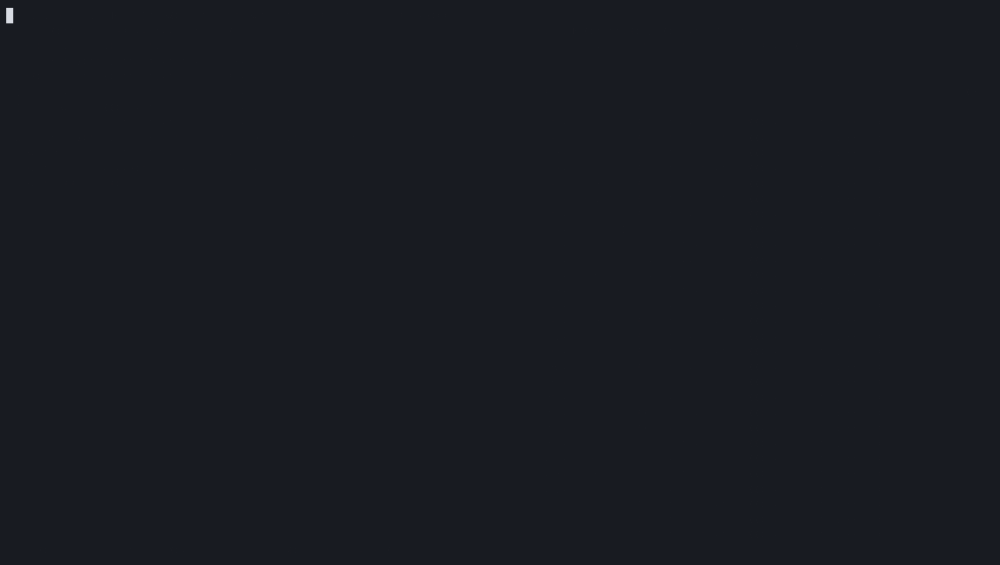
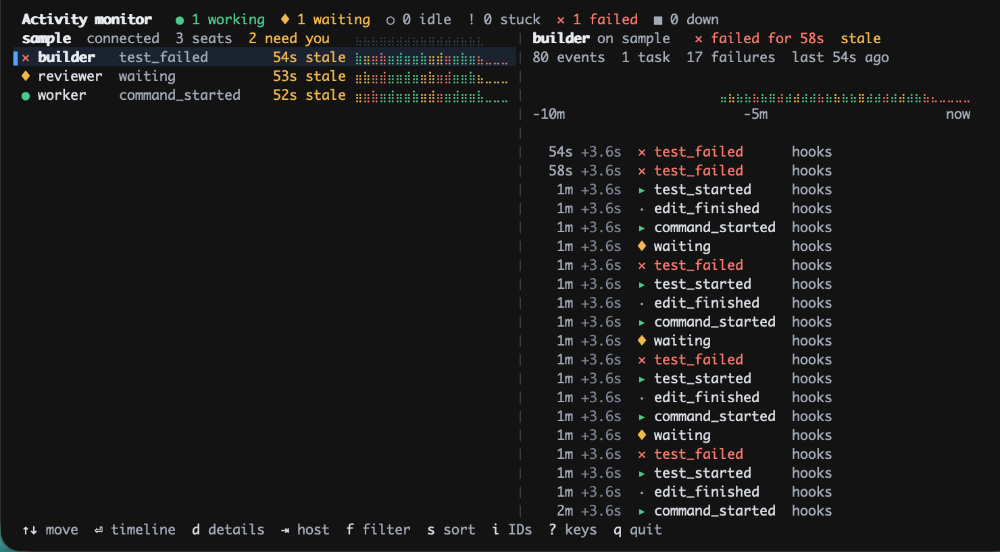
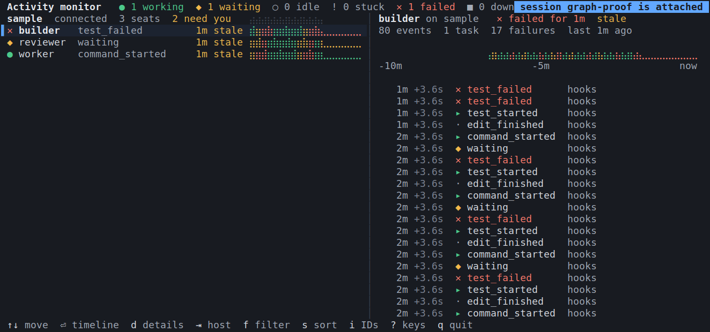
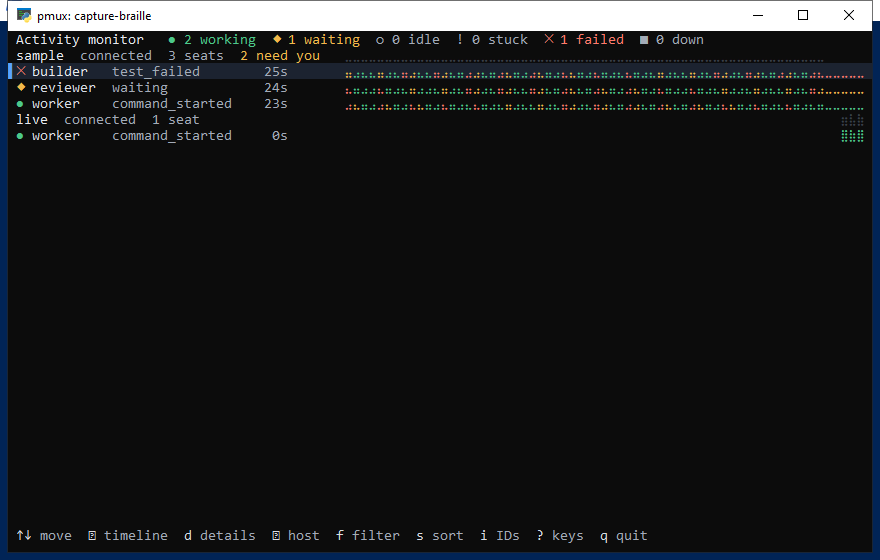

# Activity monitor UI



The activity monitor is a terminal app for a person watching agent seats on more than one machine. Its job is to answer three questions in a glance from a narrow side pane: who needs me, who is stuck or failing, and what has this seat been doing. It reads the experimental activity feed in [agent-activity-feed.md](agent-activity-feed.md) and shows host, seat, event kind, source, sequence and timing, plus bounded hook summaries: tool name, relative file label, redacted command, duration and exit status. It does not show prompts, file contents, terminal output, tool responses or mail bodies. Run and event hashes are hidden by default and can be toggled with `i`.

## Direction

The monitor speaks the same status language as Prismattyc's own chrome. In the Graphite pane chips, green means working, amber means waiting on you and coral means attention. The monitor uses those three colors for the same meanings, so a seat looks the same here as its pane does in the sidebar. Everything else stays quiet: the default terminal background (so pane transparency still shows through), one hairline color, muted secondary text and no boxes around rows.

The monitor puts its visual weight in one place: a lane for each seat. A lane is a strip of time bins that runs from the left edge of its column to now, with each bin colored by the seat's state and as tall as the activity in that bin. A run of tool calls rises as a ridge. A seat waiting on you leaves a flat amber line, and a stopped seat leaves nothing. Lanes give the overview. The timeline groups events by a known task or ticket, then shows available tool, file, command, duration and status details.

| Role | Dark | Light | Source |
| --- | --- | --- | --- |
| Working | `#4cc98a` | `#1f8a55` | Graphite working dot |
| Waiting | `#f2b84b` | `#b87a0a` | Graphite unseen/needs-you |
| Failed | `#ff7a6b` | `#c2392b` | Graphite attention |
| Stopped | `#7d8594` | `#8a929e` | Between muted text and hairline |
| Text / muted | `#e6e9ee` / `#a3abb8` | `#1f2329` / `#5b6472` | Graphite text |
| Selection / focus | `#1c2330` / `#5aa2ff` | `#eaf1fc` / `#2f6fd0` | Focused title row / focus color |
| Hairline | `#262a32` | `#d5d9df` | Graphite hairline |

Shape carries state as well as color, so the states stay distinct without color: `●` working, `◆` waiting, `○` idle, `!` stuck, `✕` failed, `■` down and `·` no state yet. The theme follows the terminal background reported by the probe and falls back to dark. `--theme light|dark` overrides it.

## State

Activity events and the daemon's live session snapshot set a seat state. Mail events leave the state unchanged.

| State | Kinds |
| --- | --- |
| Working | `working`, `turn_started`, any `*_started`, `*_finished`, `test_passed` |
| Waiting | `waiting`, `turn_finished`, `session_started` (a new session waits for its first prompt) |
| Failed | `tool_failed`, `command_failed`, `edit_failed`, `test_failed` |
| Idle | pmuxd positively detects the shell prompt and no foreground agent |
| Stuck | pmuxd detects a foreground agent with no pane output for five minutes |
| Down | `stopped`, `session_finished`, or no live pane child |

Failed stays until the seat reports something else. `*_finished` means an operation ended, so the timeline never shows it as a success. Only `test_passed` gets a check mark.

A row is stale when its last event is 30 seconds old, or when its host is disconnected. A stale row shows its age in amber, and in wider layouts it also says `stale`. Staleness never changes a seat's state. Idle requires a positive shell-prompt detection; unreadable process information stays unknown. Stuck requires a recognized foreground agent and five minutes without pane output. Down means the session has no live pane child.

Select a seat and press `d` to open its details. The top lines say who the seat
is: its harness, model, quota and project, its ticket, and how long ago it last
made progress. They come from pmux's session snapshot, and each shows `unknown`
until pmux reports it without ambiguity. The harness and project (a repository
name, never a path) appear only when every active agent pane in the session
agrees. The model comes only from explicit hook metadata for the current run.
No harness reports quota yet. The monitor never infers these values from
terminal output, agent transcripts, prompts or paths. The ticket is the most recent task
or ticket key an event carried, or `none reported`.

Below that, the seat's retained activity is grouped by task, with the most
recently active task first. Each group heading counts its activities and
failures. Each operation is one line: an operation's start and its result are
paired by run and operation id, so an edit, command, test or tool call reads as
one action. The line shows its age, a result mark, the action, the tool, the
file edited or the command run, and on the right how long it took. A failure
also shows its exit status. `✓` means it succeeded and `✗` that it failed. `…`
means it is still running. `?` means its turn or session ended without a
result. Session starts and ends, waiting for input, stops and mail appear as
short notes. Turn starts and plain working pings add no lines. Activity without
a task key is grouped under `no ticket`, and a result inherits the last task
named in its run. Commands and file names arrive already shortened and
redacted by pmux, and the view shortens them further to fit. Run and operation
ids stay hidden unless you press `i`. `↑`/`↓`, `PgUp`/`PgDn` and `g`/`G` scroll.
Press `Esc` to return to the list.

## Hosts

Each host has its own pmuxd, sequence and epoch, so the monitor keeps one cursor, connection state and seat table for each host. It never merges sequences across hosts.

```sh
pmux-activity-monitor --socket /run/pmux.sock                          # this machine, labelled mac/linux/windows
pmux-activity-monitor --host mac=/run/a.sock --host windows=/run/b.sock
pmux-activity-monitor --socket /run/pmux.sock \
  --host-cmd windows '["ssh","windows-host","pmux","activity","tail","--from-oldest"]'
```

`--host-cmd` runs a vetted JSON argv and reads `tail` JSON lines from its stdout. The argument is a JSON array, not a shell string, so nothing gets split or expanded. This reaches a remote machine through the user's own SSH, with no new listener. The monitor drops records it has already applied (same epoch, sequence not newer), so a restarted command replays safely. A command that exits is restarted with backoff. Host clocks can differ: ages from a remote host use that host's receive time, and a negative age shows as 0.

## Layout

The layout is recomputed from the pane size on every frame, so splitting or resizing the pane changes the tier immediately.

```
Wide (>= 110 cols, >= 14 rows): list and timeline side by side
 Activity monitor   ● 5 working  ◆ 2 waiting  ○ 1 idle  ! 1 stuck  ✕ 1 failed  ■ 1 down
 mac  connected  7 seats  ▁▂▅▇▅▂▁▂▃  │ worker-a  mac  ● working for 41s
▌● worker-a      command_started   4s ▁▂▅▇▆▃│ ▁▁▂▅▇▆▃▂▅▇▇▆▅▃▁▂▃▅▆▇▅▃
 ◆ reviewer-2    turn_finished    41s ▅▃▁▁▁▁│   4s  +0.4s ▸ command_started hooks  run 3fa2c1e0
 ✕ builder       test_failed       2m ▇▇▅   │  12s  +8.1s · edit_finished   hooks  run 3fa2c1e0
 windows  retrying for 12s  3 seats cached   │ ── run 77ab01c2
 ● win-agent-1   tool_started     19s stale │ ...
 ↑↓ move  ⏎ timeline  ⇥ host  f filter  s sort  p pixels  ? keys  q quit

Medium (72 to 109 cols): list with kind, age and lane; Enter opens the timeline full screen
Narrow (40 to 71 cols): glyph, seat, kind and age; no lane
Small (< 40 cols): glyph, seat and age; header shows counts only (●5 ◆2 ✕1 ■2)
Tiny (< 24 cols or < 4 rows): one line of counts
```

Text is left-aligned, ages are right-aligned in a fixed column, and lanes grow toward the right edge so "now" is always at the same place. Host rows have no box: a host label, its connection state and, in wide layouts, a lane of all its seats' activity.

## Timeline

Enter opens the timeline for the selected seat, and in the wide tier the timeline panel follows the selection. It shows the seat's retained events newest first, up to 256 per seat: age, gap since the previous event, a kind glyph (`○` session started, `▸` started, `·` finished, `✕` failed, `✓` test passed, `◆` waiting, `■` stopped, `»`/`«` mail), the kind, source, short run and event identifiers, and the daemon sequence. A hairline marks each change of run. Above the list, a ten-minute lane and a count summary (events, runs, failures) give the shape of the seat's recent work. Columns drop from the right as the width shrinks: sequence, event identifier, run, source and then gap.

## Keys

| Key | Action |
| --- | --- |
| `↑` `↓` / `k` `j` | Move the selection; in the timeline, scroll |
| `PgUp` `PgDn`, `Home` `End` / `g` `G` | Move by page, or to the first or last row |
| `Tab` / `Shift-Tab` | Jump to the next or previous host |
| `Enter` / `→` / `l` | Open the timeline |
| `Esc` / `←` / `h` | Back to the list |
| `f` | Filter: all, needs attention (waiting, stuck, failed, stale), working |
| `s` | Sort: by name, by most recent, by state |
| `x` | Remove the selected stopped session; confirm cleanup if pmuxd still tracks it |
| `X` | Clear all stopped sessions with the same confirmation and live-session refusal |
| `:` | Open the monitor command picker for either removal action |
| `p` | Toggle pixel lanes when the terminal supports them |
| `?` | Show the keys |
| `q` / `Ctrl-C` | Quit |

Sorting by name is the default, so rows don't jump while you read them.
Removal hides stale rows across refreshes. If pmuxd still tracks a stopped
agent session, confirmation removes that dead session too. If pmuxd no longer
tracks it, only the monitor row is hidden. Live sessions remain visible and
are never stopped by these actions.

## Motion and pixels

When a seat changes state in a live update, its row fades from a tint of the new state color to the normal background over 900 milliseconds. History replayed on connect, after a feed reset or while catching up does not fade, so the first frame is not covered in tints. This is the only animation the monitor starts on its own, and `--no-motion` turns it off.

Cell lanes use braille by default. Each character has two time samples and four
vertical dots in the U+2800 block. State colors are unchanged; when two samples
share a character, the later sample supplies its color.

Choose `braille`, `block`, or `ascii` when launching the monitor:

```sh
pmux-activity-monitor --graph-style braille
pmux-activity-monitor --graph-style block --no-pixels
pmux-activity-monitor --graph-style ascii
```

The persistent default lives in the Prismattyc configuration:

```toml
[mux]
activity_graph_style = "braille"
```

The complete Settings panel exposes the same choice under **Multiplexer >
Activity graph style**. The flag overrides this setting. Relaunch the monitor after changing it;
the daemon needs no restart. Omitted settings select braille. `TERM=dumb`
selects ASCII because that terminal declares text-only support. An unknown
terminal or unavailable pixel protocol keeps the chosen cell style. Terminal
probes cannot reliably determine a font's braille coverage; use the explicit
`ascii` or `block` choice if the font does not contain those glyphs.

The contained package declares `main`, `block`, and `ascii` views. Direct
`pmux plugin run org.moonbase.activity-monitor block` selects the block view;
the normal launcher applies the configuration and terminal fallback.

On a terminal that accepts raw RGBA Kitty graphics uploads, lanes render through
Lunatui's pixel sparkline as one raster per lane. The selected cell style stays
available when pixels are unsupported or disabled. `--no-pixels` selects cells;
`p` switches pixel lanes on or off at runtime without changing the cell style.

Default braille lanes with synthetic sample history on macOS, Linux, and Windows:







The Windows capture also includes a live worker pane. The same console's
[block capture](media/activity-monitor/block-windows.png) shows missing glyphs
in its font; the [ASCII capture](media/activity-monitor/ascii-windows.png) is
legible. Choose ASCII when the terminal font lacks the selected graph glyphs.

Prismattyc releases before raw-upload support decode Kitty graphics but drop raw RGBA uploads (`f=32`), which Lunatui 0.1.18 sends, and they answer every graphics query with OK. A query cannot tell the two apart, so inside Prismattyc the monitor makes one real 1x1 raw upload with an image number, followed by a device-attributes request. A Prismattyc that keeps the image answers OK first and gets pixel lanes; an older one answers only the attributes and keeps cell lanes. The probe image is deleted again, and keys typed during the probe are kept.

## Launch

With no `--socket` or `--host`, the monitor reads the pmuxd that `pmux` would use: `PMUX_INSTANCE` and `PMUX_SOCKET` (every pmux pane exports it), then the `[mux]` config, then pmux's default path. In the Prismattyc app, choose Activity Monitor in the command palette (or run `pmux space monitor`): it opens or focuses a Space named Activity Monitor and runs the monitor there. It enables local activity reading for the monitor and connector, and grants the monitor stopped-session cleanup. Cleanup is limited to agent sessions and pmuxd refuses any session with a live pane child. Choosing it again while the monitor runs changes nothing, and after `q` it starts the monitor again. In a blank Prismattyc pane, `pmux-activity-monitor` is the whole command. The `pmux activity` commands, added separately, include `pmux activity monitor [ARGS]`, which does the same with pmux's resolved socket. `--snapshot --size COLSxROWS` renders one frame as text for scripts and tests.

When the only host has nothing to show, the pane explains why instead of showing an empty list:

| Situation | What the pane says |
| --- | --- |
| The feed is turned off | Activity feed is disabled for this daemon. It is on by default; `experimental_activity = false` under `[mux]` turns it off. Set it to `true` (or remove it) in the Prismattyc config or the settings panel; the running pmuxd picks it up within a second, and the view connects by itself. |
| The pmuxd predates the feed | This pmuxd has no activity feed. Update Prismattyc and restart pmuxd; the feed is on by default. |
| No pmuxd answers | Can't reach pmuxd; start Prismattyc or run `pmux up`. |

The monitor never offers to enable the feed or restart pmuxd, because the app-managed daemon cannot be started with the feed on yet. It keeps polling, so the view fills in as soon as a feed answers.

## Runtime

Lunatui 0.1.18's `run` uses a fixed grid size, so the monitor drives the Lunatui session, encoder and pixel layer from its own small loop. That loop reads the pane size on every frame, clears and repaints in full after a resize, waits for input with a short timeout, and draws at 30 frames per second only while a fade is running. Otherwise it draws only when something changed or once per second for ages. It uses `TIOCGWINSZ` on Unix and the console buffer size on Windows. Windows runtime behavior has not been verified yet. On quit, the monitor stops each host command with its process group, then gives the feed readers one shared one-second deadline to finish before it exits without them.

## Recordings

[activity-monitor.gif](media/activity-monitor/activity-monitor.gif) is real monitor output. Two private daemons labelled `mac` and `windows` ran on one Mac with the scripted demo feed, and `windows` was read through `--host-cmd`. The monitor ran unmodified in a pseudo-terminal, `record-demo.py` sent the keys and resizes, and `agg` rendered the cast. The scenes are the wide overview, moving the selection, the full timeline, the needs-attention filter, Tab to `windows`, a stopped and restarted `windows` daemon, resizes to 100x30, 64x20, 34x14 and 22x3, the keys panel, and the light theme. The shrinking scenes keep the 150x36 canvas, so a small pane appears in the top-left corner.

[prismattyc-window.gif](media/activity-monitor/prismattyc-window.gif) shows the monitor in a real Prismattyc pane, taken from the host's own presented frames (`PRISMATTYC_DUMP_PRESENT`, timed as presented) in a clean macOS 26.6.2 VM. `record-prismattyc.py` drove it: a drill-in, then a split of the monitor's pane through the control protocol, where the monitor drops to the narrow tier beside the new shell, then the split moving back out. That Prismattyc build predates raw-upload support, so its lanes are cells.

[prismattyc-launch.gif](media/activity-monitor/prismattyc-launch.gif) is the one-command launch, also from a clean VM's Prismattyc host frames. It opens a blank pane with a `$` prompt and types `pmux-activity-monitor`. On a pmuxd with the feed off (the default when this was recorded), the pane explains that the feed is disabled. On a pmuxd started with `--experimental-activity`, with the demo feed publishing into it, the monitor fills the pane, drills in, and follows a live split. That pmuxd and host were built from this branch merged with the raw-upload support in Prismattyc #404, before #404 landed, and they draw the lanes as pixels. [prismattyc-lanes-cells-and-pixels.png](media/activity-monitor/prismattyc-lanes-cells-and-pixels.png) crops the lanes and footer from both builds: without raw-upload support the probe falls back to cells and the footer has no `p pixels`; with it the lanes are rasters.

[pixel-lane-rasters.png](media/activity-monitor/pixel-lane-rasters.png) stacks nine lane rasters exactly as the monitor uploaded them when the probe reported Kitty graphics (`record-demo.py --kitty`, then `extract-rasters.py`), padded and scaled 2x. It shows the pixel path's output, not a terminal displaying it.
