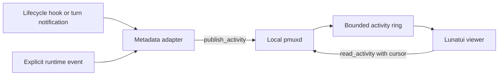

# Local agent activity feed

The experimental feed observes headless seats through an opt-in pmuxd feed and a standalone
Lunatui terminal viewer. A seat needs an explicit logical identity and a local
socket. It does not need a Prismattyc Space or terminal pane.

The feed connects lifecycle events to a live monitor. Its bounded, in-memory
history is not a durable audit log.

## Ownership and transport



`ControlPlane` owns the activity ring. Publishing never emits a topology event,
changes a session, or consumes mailbox messages. Activity has a separate sequence
so a busy producer cannot evict geometry or controller-lease events.

The two new requests reuse the existing same-user local control socket on Unix
and Windows. The daemon rejects both requests unless it was started with
`--experimental-activity` or with `experimental_activity = true` under `[mux]`
in the Prismattyc config file. pmuxd watches the config file (twice a second,
by modification time and size, plus change time and inode on Unix) and applies
that key live: turning it on starts
a fresh feed with a new boot epoch, and turning it off drops the ring, so
requests return `activity_disabled`. pmuxd is never restarted, and sessions,
panes and mail are untouched. Only a readable file with an explicit value
changes the feed: a missing, empty, unreadable or invalid config (for example,
mid-save) leaves the feed as it is and is retried until it reads cleanly, so
deleting the file does not stop the feed; set the key to `false`. `--experimental-activity` keeps the feed on for that daemon's
life whatever the key says. The native `pmux activity-emit` command installs hooks only into an explicitly
selected file. Starting the daemon or viewer never changes hook configuration.

A disabled feed returns the control error code `activity_disabled`, distinct
from `invalid_request`. The Rust client retains rejection codes in
`activity::ActivityRejected`, available through `anyhow::Error::downcast_ref`.
It omits daemon message text. A connector can map this code to `feed_disabled`
without parsing diagnostics or mistaking a malformed request for a missing capability.

Each host has its own pmuxd, socket, activity history, and random boot epoch.
The viewer reads one endpoint. Two hosts with the same seat name remain
independent. A future combined viewer needs explicit endpoint aliases, separate
cursors, and separate connection status. Sequence numbers from different daemons
have no global ordering. Remote transport and access policy need separate work.

## Current sessions

Activity responses also carry an optional `sessions` snapshot with an observation
time and every daemon session that has an agent identity. Each entry contains
only the seat identity, numeric session ID, current working/waiting/idle/stuck/
stopped state, and last pane-output time. `idle` requires a positively detected
shell prompt; `stuck` requires a detected agent process with no pane output for
five minutes. An unreadable or unsupported process tree is never treated as an
idle shell. Session names, pane titles, and screen contents stay outside the
feed. Reading this snapshot does not publish an event or advance the activity
cursor.

The contained monitor and connector receive this metadata through the existing
`activity.read` grant. The monitor refreshes discovery while open. `--seats`
includes current sessions even when they have no retained events and reports
`retained_history_only: false` when session metadata is available. Such seats
have zero retained events and sequence zero until an event arrives. Older
endpoints can omit `sessions` and continue to serve history-only views. A response
with `sessions: null` also means that current-session metadata is unavailable.

## Event schema and replay

The publisher sends one versioned JSON request per line:

```json
{"type":"publish_activity","version":1,"request_id":1,"event":{"schema_version":1,"seat":"worker-a","run_id":"run-1","event_id":"event-1","source":"runtime","kind":"working"}}
```

The normalized event has these fields:

| Field | Meaning |
| --- | --- |
| `schema_version` | Activity schema version, currently `1`. |
| `seat` | Existing validated logical agent identity. No pane lookup. |
| `run_id` | Producer run or session correlation, 1 to 128 ASCII identifier characters. |
| `event_id` | Retry identity within that seat and run, with the same identifier limit. |
| `source` | `notify`, `hooks`, or `runtime`. |
| `kind` | Closed activity enum in `activity.rs`. |
| `process_ids` | Optional process-lineage metadata for correlating hook and runtime ownership. It is omitted when unavailable and is not included in webhook payloads. |
| `detail` | Optional bounded display metadata: tool, relative file label, redacted command summary, duration, exit code, task/ticket key, and opaque operation correlation. |

Identifiers permit ASCII letters, digits, hyphens, underscores, periods, and
colons. Seat identities follow the existing mailbox identity format. The
optional `detail` record accepts only the named display fields, with printable
values capped at 256 bytes. The hook adapter caps commands at 200 characters,
redacts common credential flag/value patterns, and reports paths relative to
the hook cwd (or just a basename when the path is outside it). It discards
prompts, responses, file contents, terminal output, and mail bodies. Upstream
session and tool correlation values are hashed before publication. This format
is data minimization, not authenticated seat attribution: any client with
same-user socket access can assert a seat.

`process_ids` is a bounded list of process IDs: hook adapters report their
nearest non-shell owner, and runtime projection reports the foreground or
retained harness processes for the session's panes. The webhook worker uses this
metadata to keep hook status while runtime activity remains in that process
tree, then release it after a replacement. It does not expose process IDs in
webhook payloads.

Kinds cover session and turn start/end, tool/command/edit start/end/failure,
explicit test start/pass/failure, working/waiting/stopped state, and mail
sent/received metadata. `*_finished` means an operation ended. It does not assert
success. Test and mail events require an explicit producer; the feed does not
infer them from arbitrary command text or instrument the mailbox automatically.

The daemon adds `sequence` and `received_at_ms` to each record. A publish reply
returns an acknowledgement cursor and `duplicate`. The ring retains 512 records.
Retries with the same seat, run, and event identity return the original cursor
while retained. A retry with changed content fails. After eviction or restart,
the same identity can be accepted again. There is no durable exactly-once claim.
For matching hook tool start and finish events, the daemon adds a duration to
the finish record. Pending starts are bounded to 1,024 entries and expire after
30 minutes; unmatched finishes have no duration.

Readers send a null cursor for initial retained history:

```json
{"type":"read_activity","version":1,"request_id":1,"cursor":null,"limit":256}
```

An `ActivityPage` contains records, the boot epoch, oldest/current sequence,
`cursor`, `has_more`, and an optional reset reason. Limits are 1 through 256.
The returned cursor names the last delivered record, so paging does not skip
records. A cursor at `oldest_sequence - 1` is valid. An older cursor reports
`retention_gap`; another epoch reports `restarted`; an ahead cursor reports
`ahead_of_feed`. Reset pages return retained history successfully and leave
topology snapshot state intact. A restart loses the activity ring.

## Lifecycle adapters

The adapter consumes only documented hook or notification fields. It never reads
transcripts, authentication files, or terminal output to reconstruct tool calls.

The [turn notification reference](https://learn.chatgpt.com/docs/config-file/config-advanced#notifications)
documents a JSON argument with `agent-turn-complete`, `thread-id`, and `turn-id`.
The `--notify` adapter emits `turn_finished` only. Completion notifications alone
cannot supply a tool-by-tool timeline.

The [lifecycle hook reference](https://learn.chatgpt.com/docs/hooks) documents JSON
on stdin, session and tool correlation, and `PreToolUse` and `PostToolUse`.
The `--hook` adapter maps shell calls to command activity, patch/write calls to
edit activity, and other tools to generic tool activity. Hosted tools can lack
these hooks. Hook definitions require trust review; availability must be checked
against the installed runtime rather than inferred from notification support.

The [alternate lifecycle reference](https://code.claude.com/docs/en/hooks) and
[additional lifecycle reference](https://meta-models.github.io/muse-code-sdk/next/guides/extend/hooks/)
document the same stdin command structure. Both support `PostToolUseFailure`.
Install that optional event with `--failure-hook` only for runtimes that support
it. The default installation uses SessionStart, SessionEnd, UserPromptSubmit,
PreToolUse, PostToolUse, and Stop.

### Harness hook coverage

Hook availability and payloads differ by harness. This table records the
documented source for lifecycle and tool activity; it does not imply that the
feed installer configures every harness.

| Harness | Documented source | Useful signals | Limits |
| --- | --- | --- | --- |
| Claude Code | [Hooks reference](https://code.claude.com/docs/en/hooks) | Session lifecycle, prompt submission, pre/post tool use, failures, and stop; JSON hook input includes session and tool context for applicable events. | Hooks must be configured in the user's trusted settings. Hosted tools and surfaces can have different hook support. |
| Codex | [Hooks guide](https://learn.chatgpt.com/docs/hooks) | Session start, prompt submission, tool lifecycle, subagent lifecycle, stop, and interruption. Applicable payloads include session ID, model, working directory, and tool metadata. | Hook schemas and supported events depend on the Codex version and surface. Quota state is not a documented hook field. |
| Muse Code | [Hooks guide](https://meta-models.github.io/muse-code-sdk/next/guides/extend/hooks/) | Session and prompt lifecycle, tool success/failure, model calls, subagents, and stop. Hooks receive JSON on stdin; event-specific payloads are documented separately. | Project hooks run only for trusted workspaces. Quota state is not a documented hook field. |
| Gemini CLI | [Hooks reference](https://geminicli.com/docs/hooks/reference/) | Session lifecycle, prompt/agent/model events, and before/after tool events. Hook input is JSON on stdin and includes session ID, cwd, event name, and timestamp. | Hooks are configured in Gemini settings. Tool responses and prompts can contain content, so the activity adapter must discard them. Quota state is not a documented hook field. |
| Kiro | [Hook types](https://kiro.dev/docs/hooks/types/) and [configuration reference](https://kiro.dev/docs/custom-agents/configuration-reference/) | Prompt, session, agent, and pre/post tool lifecycle, depending on Kiro surface/version. Command hooks receive event JSON. | Trigger support differs across IDE, CLI versions, and Web; Web does not run these local triggers. Quota state is not a documented hook field. |

Use pmux's current session roster as the identity and liveness source. Hooks
provide activity transitions and may add explicitly documented metadata, but
must be bound to a pmux session rather than allowed to create an unnamed seat.
Treat project as the session's cwd when available. Model, quota, current task,
and ticket are unknown unless a documented field or explicit local integration
supplies them; do not read transcripts, credentials, or terminal output to fill
gaps. In particular, no source listed above documents a quota-state field.

Hooks and notifications return success when observation fails and never write
hook-control output to stdout. A disabled feed is a silent no-op. Other failures
produce a fixed diagnostic without upstream input or daemon message text. Hook
stdin is limited to 1 MiB and a two-second wait. Connect, write, and read share a
separate two-second deadline. Installed handlers have a five-second timeout.
There is no spool or automatic retry. Correlated events have stable retry
identities; lifecycle events without correlation receive new identities.

## Run the feed

First prepare a verified production bundle and build matched consumers as described in [Build from source](../tools/activity-monitor/README.md#build-from-source). A source build without that bundle has an empty catalog. For feed ingestion only, build the daemon and adapter from the repository root:

```sh
cargo build -p prismattyc-mux --bins --locked
cargo build --manifest-path tools/activity-monitor/Cargo.toml --locked
```

Start a separate development daemon with a private absolute socket path:

```sh
target/debug/pmuxd --experimental-activity --socket /tmp/activity-demo/feed.sock -- /bin/sh
```

The parent directory must exist and be private to the user. Do not replace a
running daemon or point verification at an operator socket.

Before opening the contained viewer, install and approve its exact package on this private daemon. Collection enablement does not grant plug-in access:

```sh
target/debug/pmux --socket /tmp/activity-demo/feed.sock plugin install org.moonbase.activity-monitor --version 1.0.0
target/debug/pmux --socket /tmp/activity-demo/feed.sock plugin enable org.moonbase.activity-monitor --version 1.0.0 --allow activity.read:local
target/debug/pmux --socket /tmp/activity-demo/feed.sock plugin install org.moonbase.activity-connector --version 1.0.0
target/debug/pmux --socket /tmp/activity-demo/feed.sock plugin enable org.moonbase.activity-connector --version 1.0.0 --allow activity.read:local
```

Installation leaves both packages disabled. The connector serves JSON query modes and explicit native MCP exports. Settings > Plug-ins offers the same version and permission review. Existing 0.3.54 collection settings do not silently approve either package after upgrade.

Start the viewer in another terminal:

```sh
target/debug/pmux-activity-monitor --socket /tmp/activity-demo/feed.sock
```

Install a per-seat hook profile using absolute paths:

```sh
target/debug/pmux --socket /tmp/activity-demo/feed.sock activity-emit \
  --seat worker-a --install-hooks /absolute/path/worker-a-hooks.json
```

For a user-level install across Claude Code, Codex, Cursor, and Kiro, set the
agent identity in the harness environment and run:

```sh
PMUX_AGENT=worker-a target/debug/pmux --socket /tmp/activity-demo/feed.sock \
  activity-emit --install-hooks --all-harnesses
```

This writes Claude settings to `~/.claude/settings.json`, Codex hooks to
`~/.codex/hooks.json`, Cursor hooks to `~/.cursor/hooks.json`, and a Kiro hook
profile to `~/.kiro/hooks/pmux-activity.json`. The installed command reads
`PMUX_AGENT` when the hook runs, so set it in the environment inherited by the
harness too. Cursor and Kiro event names are translated to the activity schema.
The installer removes and replaces only handlers marked as pmux activity
handlers; unrelated settings and hooks are retained. Review and approve the
generated hooks using each harness's normal trust controls.

Independently, `pmuxd` publishes pane-state transitions for every
agent-bound session. It reports `stopped` when no pane child is running,
`working` after recent pane output, and `waiting` after a minute without output.
These runtime records coexist with harness hook events, so sessions remain
visible when hooks are absent or a harness changes within a pane.

Load a per-seat file through the runtime's documented settings or managed-hook
option. Use `--schema-version 1` when its loader requires that field. In
per-seat mode, the generated command embeds the explicit socket and seat.

Installation merges JSON settings under a file lock and commits atomically.
It preserves unrelated settings, handlers, and managed-hook pointers. Repeating
an identical installation leaves the file unchanged. Invalid JSON fails without
replacement. Remove only the adapter's marked handlers with:

```sh
target/debug/pmux --socket /tmp/activity-demo/feed.sock activity-emit \
  --seat worker-a --remove-hooks /absolute/path/worker-a-hooks.json
```

For a manually configured lifecycle command, use the absolute `pmux` executable
followed by `--socket PATH activity-emit --seat worker-a --hook`. For turn
notifications, replace `--hook` with `--notify`; the runtime appends its JSON
argument. Explicit producers use `--event JSON` with the normalized schema.
On Windows, use absolute paths to `pmux.exe` and a private socket. The installer
rejects paths containing command expansion characters it cannot quote safely.

The viewer polls every 250 ms on a background thread. A bounded channel separates
network reads from rendering, and the cache keeps at most 128 seats. Timer frames
make new events visible without keyboard input. Resets clear the cache before
replay. Seats without an event for 30 seconds display as stale, which does not
mean their processes died. Disconnection leaves cached rows visibly stale and
retries the endpoint. Press `q` to exit.

`--snapshot` renders one 120 by 24 Lunatui grid as text. `--json` reads one bounded
page; add `--since EPOCH:SEQUENCE` to resume from a cursor printed in the page, or
`--since UNIX_MILLISECONDS` to begin at a retained event time. A time query returns
the first bounded page at or after that Unix timestamp, with a cursor for resuming.
If the requested time predates the oldest retained event, `reset` is
`retention_gap`. Both report pending history if the page does not contain the full
buffer.
The standalone tool pins Lunatui v0.1.18 by commit and has its own lockfile, so
ordinary workspace builds do not acquire the viewer dependency.

## Bot access through Shell

## Signed webhook delivery

Webhook delivery is opt-in. Set both `[mux] activity_webhook_url` and
`activity_webhook_secret_file`; the latter names a file containing at least 32
bytes of key material. An inline `activity_webhook_secret` is rejected. The
webhook setting enables the daemon activity feed. A newly enabled receiver starts
from the current cursor, so it does not replay retained events from before opt-in.

Each POST uses `Content-Type: application/json`,
`X-Prismattyc-Timestamp` (Unix seconds), and
`X-Prismattyc-Signature: sha256=<hex>`. The HMAC input is the timestamp, a dot,
and the exact raw request body. Receivers should reject timestamps more than 300
seconds from their clock, then compare signatures with a constant-time function.
The bounded payload has `seat`, `state`, `reason`, `pane_id`, `space`, and
`timestamp`. The reason is a safe generic activity label; no prompt text is
included. Pane and Space are `null` when the activity record does not identify
them.

Hook events take precedence in webhook status while their run is active, so
pane-state inference does not replace a specific tool failure or stop event.
A hook `SessionEnd` or pane `stopped` transition releases that precedence and
lets runtime state report a later hookless run. A change in pane process identity
also releases it, which covers a replacement harness without an end hook.

Python verification example:

```python
import hashlib
import hmac
import time

def verify(raw_body: bytes, headers: dict[str, str], secret: bytes) -> bool:
    timestamp = headers["X-Prismattyc-Timestamp"]
    if abs(int(time.time()) - int(timestamp)) > 300:
        return False
    expected = "sha256=" + hmac.new(
        secret, timestamp.encode() + b"." + raw_body, hashlib.sha256
    ).hexdigest()
    return hmac.compare_digest(expected, headers["X-Prismattyc-Signature"])
```

The daemon coalesces updates per seat, holds at most 64 queued deliveries, and
retries transient failures with exponential backoff before dropping a delivery
after six attempts. Delivery runs on a background thread and does not block
pmuxd's control path. Logs and errors omit webhook URLs, query strings, userinfo,
secret contents, and receiver response bodies.

A bot with Shell access to a host can query the same private socket without
opening a terminal UI. The monitor's connector modes emit JSON:

```sh
target/debug/pmux-activity-monitor --socket /tmp/activity-demo/feed.sock --seats
target/debug/pmux-activity-monitor --socket /tmp/activity-demo/feed.sock --recent worker-a
target/debug/pmux-activity-monitor --socket /tmp/activity-demo/feed.sock --tail --seat worker-a
```

`--seats` lists seats observed in retained events. It does not assert that a
process is alive. `--recent` returns retained events for one validated seat.
Finite queries drain bounded pages rather than returning only the first page.
`--tail` emits cursor-bearing JSON lines with reset information and optional
seat filtering. Filtering must still advance the underlying cursor through
unmatched events. A consumer treats reset as lost continuity and never infers
successful work from an idle connection.

The bot runs its command on the machine owning that daemon. It supplies an
explicit endpoint and a neutral host label in its own result aggregation.
Shell access provides the existing local-user trust boundary. The feed adds
no network listener or credentials, and the connector does not publish events,
consume mail, or send terminal input.

A read-only MCP option can wrap this same bounded API with `activity_list_seats`,
`activity_recent`, and `activity_poll` tools. Each call returns a bounded JSON
result and an explicit cursor/reset. Prefer polling tools over an indefinitely
open tool call. The server needs an operator-configured endpoint allowlist,
page/rate limits, and host labels. It must not accept arbitrary socket paths
from tool arguments. MCP packaging and access policy are design work only in
this version. The existing Shell connector supplies the usable integration now.

## Reproduce the proof

```sh
python3 scripts/verify-activity.py \
  --bins target/debug \
  --monitor target/debug/pmux-activity-monitor \
  --out /tmp/activity-proof-new
```

This portable driver creates isolated configuration and a private daemon, opens a
real PTY or ConPTY terminal viewer, and emits a hook event after the first frame. It requires
the new seat to appear without keyboard input. It also checks default-off
rejection, metadata omission, retry conflict, pagination, retention boundaries,
restart epochs, unchanged topology, bounded stdin, and hook install/remove
preservation. A reviewed `--producer-command FILE` can invoke an installed
runtime with `{hooks}` and `{project}` placeholders. The driver runs it before
and after removal, proving that an independent existing handler still runs and
that adapter publication stops after removal. Record the actual runtime and
version separately; synthetic events alone do not establish runtime integration. It retains a rendered grid, live terminal
text, and a JSON result, then reaps its direct child processes and removes scratch state.

To exercise a real producer, pass `--producer-command FILE`. The file is a vetted
JSON argv array. Its arguments can contain `{socket}`, `{emitter}`, and `{seat}`
placeholders. The driver runs it in a private working directory, then requires
an actual hook or notification event from that seat. Review the producer command
before running it. Runner authentication uses its normal environment. The proof
does not save raw producer output or configuration.

Require a native Windows drive before claiming Windows runtime support.
A macOS drive or cross-compilation alone is insufficient. The Windows driver
prepares a private socket-directory ACL and connects through Winsock when Python
lacks an AF_UNIX path codec. Record platform, source revision, build commands,
exits, the rendered terminal, and the result JSON with each proof.

## Design choice and original planning estimate

Two designs were compared. The native ring keeps one state owner and two
operations. A durable sidecar journal still needs daemon routing, plus another
process, queue, file recovery, retention, and shutdown policy. The spike selected the ring. The viewer retains the sidecar design's background reader,
bounded cache, explicit resets, and live-terminal verification.

The original spike estimated 6 to 9 engineering days for a local v1 with
bounded, process-local retention. This planning range included the separately
owned connector and viewer work:

| Work | Engineering days |
| --- | --- |
| Schema, capability reporting, retention and delivery policy | 1 to 2 |
| Reviewed harness adapters and installation procedures | 2 |
| Viewer navigation, JSON connector, reconnect and stale state | 1 to 2 |
| Mail/status producers, Windows packaging and failure proof | 2 to 3 |

The estimate is a planning range, not a measurement. It assumes a confirmed event
interface for each runtime. Durable history adds a journal/recovery design.
Remote aggregation adds roughly 2 to 4 days after transport and access policy
are agreed. A packaged read-only MCP connector adds roughly 1 to 2 days for
endpoint policy, tool schemas, limits, and client proof. Authenticated per-seat
attribution and a new upstream runtime event API need separate estimates.
