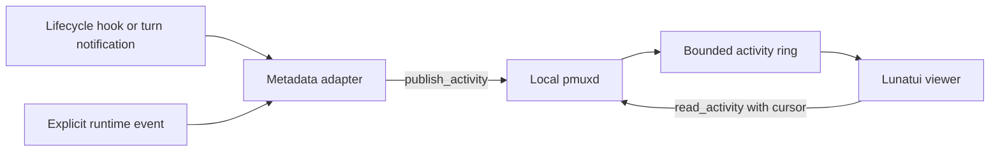

# Local agent activity feed

The experimental feed observes headless seats through an opt-in pmuxd feed and a standalone
Lunatui terminal viewer. A seat needs an explicit logical identity and a local
socket. It does not need a Prismattyc Space or terminal pane.

The feed connects lifecycle events to a live monitor. Its bounded, in-memory
history is not a durable audit log.

## Ownership and transport



`ControlPlane` owns the activity ring. Publishing never emits a topology event,
changes a session, or consumes mailbox messages. Activity has a separate sequence
so a busy producer cannot evict geometry or controller-lease events.

The two new requests reuse the existing same-user local control socket on Unix
and Windows. The daemon rejects both requests unless it was started with
`--experimental-activity` or with `experimental_activity = true` under `[mux]`
in the Prismattyc config file. pmuxd reads that key once at startup, so the
app-managed daemon serves the feed after its next start; a running daemon is
never restarted or changed by the setting. The native `pmux activity-emit` command installs hooks only into an explicitly
selected file. Starting the daemon or viewer never changes hook configuration.

A disabled feed returns the control error code `activity_disabled`, distinct
from `invalid_request`. The Rust client retains rejection codes in
`activity::ActivityRejected`, available through `anyhow::Error::downcast_ref`.
It omits daemon message text. A connector can map this code to `feed_disabled`
without parsing diagnostics or mistaking a malformed request for a missing capability.

Each host has its own pmuxd, socket, activity history, and random boot epoch.
The viewer reads one endpoint. Two hosts with the same seat name remain
independent. A future combined viewer needs explicit endpoint aliases, separate
cursors, and separate connection status. Sequence numbers from different daemons
have no global ordering. Remote transport and access policy need separate work.

## Event schema and replay

The publisher sends one versioned JSON request per line:

```json
{"type":"publish_activity","version":1,"request_id":1,"event":{"schema_version":1,"seat":"worker-a","run_id":"run-1","event_id":"event-1","source":"runtime","kind":"working"}}
```

The normalized event has these fields:

| Field | Meaning |
| --- | --- |
| `schema_version` | Activity schema version, currently `1`. |
| `seat` | Existing validated logical agent identity. No pane lookup. |
| `run_id` | Producer run or session correlation, 1 to 128 ASCII identifier characters. |
| `event_id` | Retry identity within that seat and run, with the same identifier limit. |
| `source` | `notify`, `hooks`, or `runtime`. |
| `kind` | Closed activity enum in `activity.rs`. |

Identifiers permit ASCII letters, digits, hyphens, underscores, periods, and
colons. Seat identities follow the existing mailbox identity format.
The daemon accepts no free-text summary, arguments, command text, prompts,
responses, file paths, file contents, or mail bodies. Adapters hash upstream
correlation identifiers before publication. Operators still choose neutral seat
identities. This format is data minimization, not authenticated seat attribution:
any client with same-user socket access can assert a seat.

Kinds cover session and turn start/end, tool/command/edit start/end/failure,
explicit test start/pass/failure, working/waiting/stopped state, and mail
sent/received metadata. `*_finished` means an operation ended. It does not assert
success. Test and mail events require an explicit producer; the feed does not
infer them from arbitrary command text or instrument the mailbox automatically.

The daemon adds `sequence` and `received_at_ms` to each record. A publish reply
returns an acknowledgement cursor and `duplicate`. The ring retains 512 records.
Retries with the same seat, run, and event identity return the original cursor
while retained. A retry with changed content fails. After eviction or restart,
the same identity can be accepted again. There is no durable exactly-once claim.

Readers send a null cursor for initial retained history:

```json
{"type":"read_activity","version":1,"request_id":1,"cursor":null,"limit":256}
```

An `ActivityPage` contains records, the boot epoch, oldest/current sequence,
`cursor`, `has_more`, and an optional reset reason. Limits are 1 through 256.
The returned cursor names the last delivered record, so paging does not skip
records. A cursor at `oldest_sequence - 1` is valid. An older cursor reports
`retention_gap`; another epoch reports `restarted`; an ahead cursor reports
`ahead_of_feed`. Reset pages return retained history successfully and leave
topology snapshot state intact. A restart loses the activity ring.

## Lifecycle adapters

The adapter consumes only documented hook or notification fields. It never reads
transcripts, authentication files, or terminal output to reconstruct tool calls.

The [turn notification reference](https://learn.chatgpt.com/docs/config-file/config-advanced#notifications)
documents a JSON argument with `agent-turn-complete`, `thread-id`, and `turn-id`.
The `--notify` adapter emits `turn_finished` only. Completion notifications alone
cannot supply a tool-by-tool timeline.

The [lifecycle hook reference](https://learn.chatgpt.com/docs/hooks) documents JSON
on stdin, session and tool correlation, and `PreToolUse` and `PostToolUse`.
The `--hook` adapter maps shell calls to command activity, patch/write calls to
edit activity, and other tools to generic tool activity. Hosted tools can lack
these hooks. Hook definitions require trust review; availability must be checked
against the installed runtime rather than inferred from notification support.

The [alternate lifecycle reference](https://code.claude.com/docs/en/hooks) and
[additional lifecycle reference](https://meta-models.github.io/muse-code-sdk/next/guides/extend/hooks/)
document the same stdin command structure. Both support `PostToolUseFailure`.
Install that optional event with `--failure-hook` only for runtimes that support
it. The default installation uses SessionStart, SessionEnd, UserPromptSubmit,
PreToolUse, PostToolUse, and Stop.

Hooks and notifications return success when observation fails and never write
hook-control output to stdout. A disabled feed is a silent no-op. Other failures
produce a fixed diagnostic without upstream input or daemon message text. Hook
stdin is limited to 1 MiB and a two-second wait. Connect, write, and read share a
separate two-second deadline. Installed handlers have a five-second timeout.
There is no spool or automatic retry. Correlated events have stable retry
identities; lifecycle events without correlation receive new identities.

## Run the feed

Build the daemon and adapter from the repository root:

```sh
cargo build -p prismattyc-mux --bins --locked
cargo build --manifest-path tools/activity-monitor/Cargo.toml --locked
```

Start a separate development daemon with a private absolute socket path:

```sh
target/debug/pmuxd --experimental-activity --socket /tmp/activity-demo/feed.sock -- /bin/sh
```

The parent directory must exist and be private to the user. Do not replace a
running daemon or point verification at an operator socket.

Start the viewer in another terminal:

```sh
tools/activity-monitor/target/debug/pmux-activity-monitor --socket /tmp/activity-demo/feed.sock
```

Install a per-seat hook profile using absolute paths:

```sh
target/debug/pmux --socket /tmp/activity-demo/feed.sock activity-emit \
  --seat worker-a --install-hooks /absolute/path/worker-a-hooks.json
```

Load that file through the runtime's documented settings or managed-hook option.
Use `--schema-version 1` when its loader requires that field. Runtime hooks can
run with a stripped environment, so the generated command embeds the explicit
socket and seat. A shared global file with one fixed seat would misattribute
other sessions. Use a separate profile for each seat.

Installation merges JSON settings under a file lock and commits atomically.
It preserves unrelated settings, handlers, and managed-hook pointers. Repeating
an identical installation leaves the file unchanged. Invalid JSON fails without
replacement. Remove only the adapter's marked handlers with:

```sh
target/debug/pmux --socket /tmp/activity-demo/feed.sock activity-emit \
  --seat worker-a --remove-hooks /absolute/path/worker-a-hooks.json
```

For a manually configured lifecycle command, use the absolute `pmux` executable
followed by `--socket PATH activity-emit --seat worker-a --hook`. For turn
notifications, replace `--hook` with `--notify`; the runtime appends its JSON
argument. Explicit producers use `--event JSON` with the normalized schema.
On Windows, use absolute paths to `pmux.exe` and a private socket. The installer
rejects paths containing command expansion characters it cannot quote safely.

The viewer polls every 250 ms on a background thread. A bounded channel separates
network reads from rendering, and the cache keeps at most 128 seats. Timer frames
make new events visible without keyboard input. Resets clear the cache before
replay. Seats without an event for 30 seconds display as stale, which does not
mean their processes died. Disconnection leaves cached rows visibly stale and
retries the endpoint. Press `q` to exit.

`--snapshot` renders one 120 by 24 Lunatui grid as text. `--json` reads one bounded
page. Both report pending history if the page does not contain the full buffer.
The standalone tool pins Lunatui v0.1.18 by commit and has its own lockfile, so
ordinary workspace builds do not acquire the viewer dependency.

## Bot access through Shell

A bot with Shell access to a host can query the same private socket without
opening a terminal UI. The monitor's connector modes emit JSON:

```sh
tools/activity-monitor/target/debug/pmux-activity-monitor --socket /tmp/activity-demo/feed.sock --seats
tools/activity-monitor/target/debug/pmux-activity-monitor --socket /tmp/activity-demo/feed.sock --recent worker-a
tools/activity-monitor/target/debug/pmux-activity-monitor --socket /tmp/activity-demo/feed.sock --tail --seat worker-a
```

`--seats` lists seats observed in retained events. It does not assert that a
process is alive. `--recent` returns retained events for one validated seat.
Finite queries drain bounded pages rather than returning only the first page.
`--tail` emits cursor-bearing JSON lines with reset information and optional
seat filtering. Filtering must still advance the underlying cursor through
unmatched events. A consumer treats reset as lost continuity and never infers
successful work from an idle connection.

The bot runs its command on the machine owning that daemon. It supplies an
explicit endpoint and a neutral host label in its own result aggregation.
Shell access provides the existing local-user trust boundary. The feed adds
no network listener or credentials, and the connector does not publish events,
consume mail, or send terminal input.

A read-only MCP option can wrap this same bounded API with `activity_list_seats`,
`activity_recent`, and `activity_poll` tools. Each call returns a bounded JSON
result and an explicit cursor/reset. Prefer polling tools over an indefinitely
open tool call. The server needs an operator-configured endpoint allowlist,
page/rate limits, and host labels. It must not accept arbitrary socket paths
from tool arguments. MCP packaging and access policy are design work only in
this version. The existing Shell connector supplies the usable integration now.

## Reproduce the proof

```sh
python3 scripts/verify-activity.py \
  --bins target/debug \
  --monitor tools/activity-monitor/target/debug/pmux-activity-monitor \
  --out /tmp/activity-proof-new
```

This portable driver creates isolated configuration and a private daemon, opens a
real PTY or ConPTY terminal viewer, and emits a hook event after the first frame. It requires
the new seat to appear without keyboard input. It also checks default-off
rejection, metadata omission, retry conflict, pagination, retention boundaries,
restart epochs, unchanged topology, bounded stdin, and hook install/remove
preservation. A reviewed `--producer-command FILE` can invoke an installed
runtime with `{hooks}` and `{project}` placeholders. The driver runs it before
and after removal, proving that an independent existing handler still runs and
that adapter publication stops after removal. Record the actual runtime and
version separately; synthetic events alone do not establish runtime integration. It retains a rendered grid, live terminal
text, and a JSON result, then reaps its direct child processes and removes scratch state.

To exercise a real producer, pass `--producer-command FILE`. The file is a vetted
JSON argv array. Its arguments can contain `{socket}`, `{emitter}`, and `{seat}`
placeholders. The driver runs it in a private working directory, then requires
an actual hook or notification event from that seat. Review the producer command
before running it. Runner authentication uses its normal environment. The proof
does not save raw producer output or configuration.

Require a native Windows drive before claiming Windows runtime support.
A macOS drive or cross-compilation alone is insufficient. The Windows driver
prepares a private socket-directory ACL and connects through Winsock when Python
lacks an AF_UNIX path codec. Record platform, source revision, build commands,
exits, the rendered terminal, and the result JSON with each proof.

## Design choice and original planning estimate

Two designs were compared. The native ring keeps one state owner and two
operations. A durable sidecar journal still needs daemon routing, plus another
process, queue, file recovery, retention, and shutdown policy. The spike selected the ring. The viewer retains the sidecar design's background reader,
bounded cache, explicit resets, and live-terminal verification.

The original spike estimated 6 to 9 engineering days for a local v1 with
bounded, process-local retention. This planning range included the separately
owned connector and viewer work:

| Work | Engineering days |
| --- | --- |
| Schema, capability reporting, retention and delivery policy | 1 to 2 |
| Reviewed harness adapters and installation procedures | 2 |
| Viewer navigation, JSON connector, reconnect and stale state | 1 to 2 |
| Mail/status producers, Windows packaging and failure proof | 2 to 3 |

The estimate is a planning range, not a measurement. It assumes a confirmed event
interface for each runtime. Durable history adds a journal/recovery design.
Remote aggregation adds roughly 2 to 4 days after transport and access policy
are agreed. A packaged read-only MCP connector adds roughly 1 to 2 days for
endpoint policy, tool schemas, limits, and client proof. Authenticated per-seat
attribution and a new upstream runtime event API need separate estimates.
