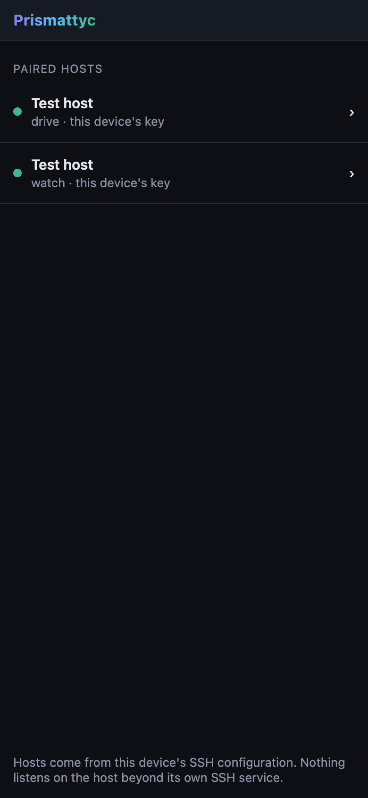
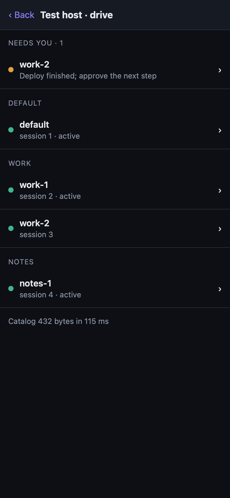
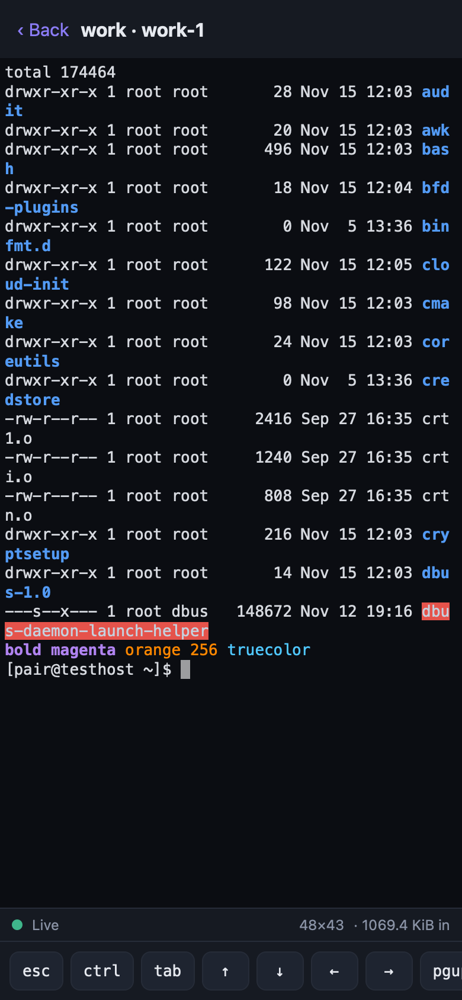
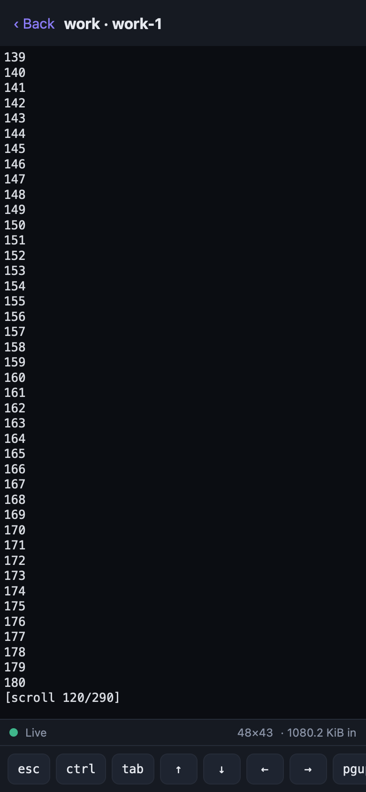
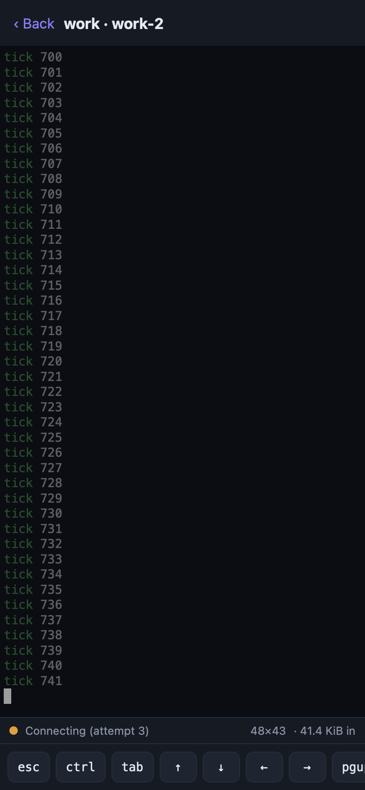
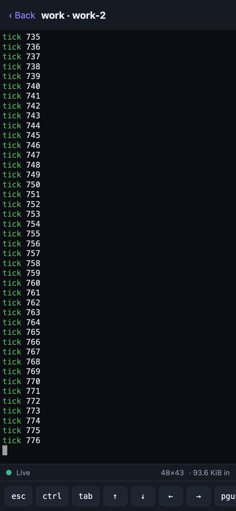
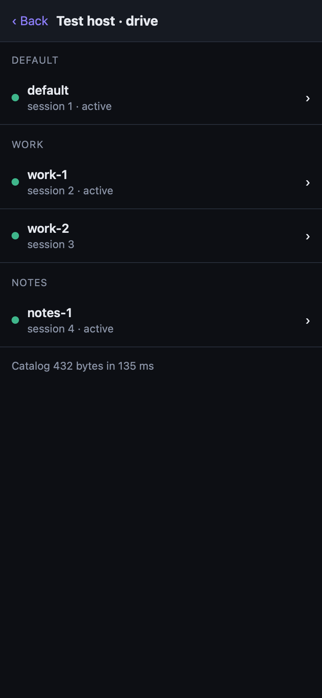
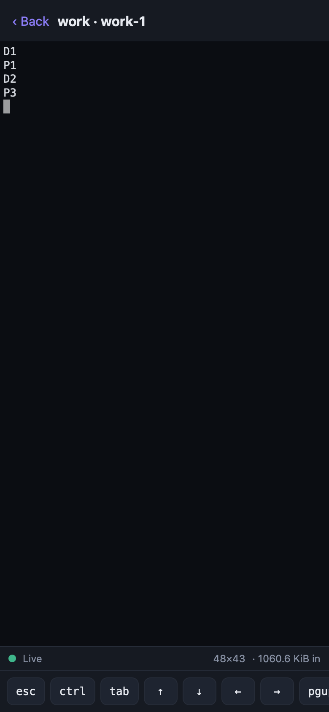
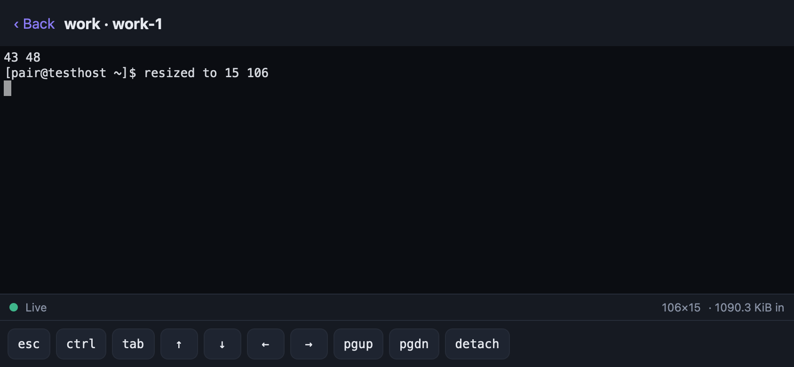

# Companion catalog and live terminal: prototype findings

Status: **evidence from a time-boxed spike, not shipped behavior.** The
prototype was disposable and is not part of this change. Nothing here alters
the pmux server, the attach client or any shipped command.

Base: `origin/main` `3bba8e8f`. The transport follows the decision record in
[`remote-attach-transport.md`](remote-attach-transport.md) (in review): SSH to
the host's own SSH server, one restricted key per device, and a fixed gate as
the forced command.

## Summary

A phone-sized prototype listed a paired host's running Spaces and sessions
and drove one pane as a terminal. It used only the system SSH client, opened
no listener and went through a stand-in for the proposed gate. It ran against
an isolated account on a disposable test host.

1. **The existing catalog command and attach path are enough for v1's single
   pane.** The catalog came back in 115–165 ms with 432 bytes. Attach painted
   its first screen 125–165 ms after the SSH command started. Colour, input,
   server-side scrollback, rotation, detach and reconnect all worked without
   any host change.
2. **Watch and drive scopes work as the gate proposes.** A key installed with
   `restrict,pty` and a forced command reached only the gate. A watch key's
   attach ran `--read-only`, and its typed text never reached the pane. Socket
   forwarding to the pmux socket was refused for the restricted key. The same
   forward with an unrestricted key registered a control client.
3. **A dropped link recovers on its own and the session keeps running.** With
   all SSH traffic to the host blocked for 20 s, the client marked the link
   lost 7–8 s in, reconnected 3 s after traffic returned, and the pane's
   output had no gaps.
4. **The PTY path is costly where the phone matters most.** For a pane
   printing one short line a second, attach sent about 3.1 KiB per line,
   because it repaints every row when the screen scrolls. The pane's own
   output was 19 bytes per line. The server's typed pane subscription carried
   the same line in about 230 bytes.
5. **Several v2 features need a typed screen and event channel.** These are
   multi-pane swipe, visible input leases, low bandwidth, native scrolling,
   resume after a network change, and accessibility. That channel can be a
   gate verb over the same SSH connection, built from requests the pmux
   server already serves. No listener is needed.

## What was built

The prototype has three parts. None of them is in this change.

| Part | What it does |
| --- | --- |
| Window | A 390×844 pt window with a web view, standing in for a phone. It shows paired hosts, a Space and session list with a needs-you section, and a terminal with a key bar (esc, ctrl, tab, arrows, page keys, detach). Rotation is a window resize to 844×390. |
| Core | A helper process that links the Prismattyc emulator crate. It runs `ssh -tt` in a local PTY, feeds the bytes to the emulator, and sends styled rows to the window about 30 times a second while the screen changes. It reconnects with backoff (0.5 s doubling to 8 s) and keeps the last screen up, dimmed, while it does. |
| Gate stand-in | A short script installed as the forced command for two P-256 device keys, one `drive` and one `watch`. It splits `SSH_ORIGINAL_COMMAND` with no shell evaluation and accepts `hello`, `catalog`, `inbox` and `attach SESSION_ID SPACE_ID`. The watch scope adds `--read-only` to attach. |

The window was a desktop web view because no mobile toolchain was available
on the build machine. The interaction under test is the same one a phone app
would have. The phone-only parts are listed under
[Not proven here](#not-proven-here).

The test host was a disposable virtual machine with a test-only account and
its own pmux server, built from the base commit. It had two Spaces: `work`
(two sessions, one printing a numbered line every second) and `notes`. The
prototype reached it through that machine's ordinary SSH server via a jump
host. The machine was deleted after the run.

## Results

| Requirement | Result |
| --- | --- |
| List live Spaces and sessions | `catalog`: 432 bytes, 115–165 ms over 12 runs (8 through the gate). Attach's first paint took 125–165 ms over 14 attaches on a working link. Sessions show their Space and which one is active. |
| Needs-you inbox | `inbox` through the gate ran `pmux space attention` per Space: 1,691 bytes for three Spaces. A message raised with `pmux attention` appeared as the first section. |
| Render one pane as a usable terminal | 16-colour, 256-colour and 24-bit colour, bold and inverse all rendered. Typed text, control keys and arrows reached the shell. |
| Scrollback | The wheel (standing in for a vertical swipe) sent mouse reports that put attach into its server-side scroll mode, 3 lines per step. `seq 1 300` then 40 steps showed lines 139–180 under a `[scroll 120/290]` marker. Esc returned to the live screen. |
| Resize | Rotation to landscape changed the grid from 48×43 to 106×15. The remote shell's `SIGWINCH` handler printed the new size about 140 ms after the resize was sent, in both timed runs (138 and 140 ms). |
| Detach leaves the session running | Back sent attach's detach chord. SSH exited 0 within 35 ms. `pmux clients` was empty, the pane was alive, and a background `sleep` started before detach was still running. |
| Reconnect after a dropped link | All TCP traffic to the host's SSH port was dropped for 20 s, twice. The client marked the link lost 7.2 s and 7.9 s in (SSH keepalive every 2 s, 3 misses). It reconnected 2.7 s and 3.4 s after traffic returned (±1 s from clock alignment). The 42 numbered lines on screen afterwards had no gaps, and lines printed during the outage were among them. |
| Watch scope | Attach showed `[ro]`. Text typed on the watch device did not reach a pane running `cat > file`. Text typed earlier on the drive device did. |
| No new listener | The prototype opened no TCP or Unix socket listener. All traffic went through the system SSH client to the host's existing SSH server. |

The status line counts bytes received from the SSH PTY, which is the
payload before SSH encryption and framing.

### Captures

| | | |
| --- | --- | --- |
|  |  |  |
| Paired hosts | Inbox and catalog through the gate | Colour and input |
|  |  |  |
| Scrollback through attach's scroll mode | Link lost during a 20 s block | Reconnected, no gaps |
|  |  | |
| After detach | Lease collision (see below) | |

## Where PTY over SSH is good enough

For v1 (watch, full terminal input, and a needs-you inbox, one pane at a
time) the existing path holds up:

- **Catalog and inbox** are small one-shot commands. They fit a gate verb
  each and need no streaming while the app is open and polls.
- **One attached pane** gets correct rendering, input, rotation, detach and
  reconnect with no host change. The phone runs the Prismattyc emulator on
  the attach client's output, exactly as the prototype did.
- **Watch scope** is attach's existing `--read-only`.
- **Idle cost is zero.** Over 20 s on an unchanging screen, attach sent no
  bytes.
- **Stale attaches do not block input.** Attach takes the input lease on the
  first key and drops it after 750 ms idle. In a simulated network switch, the
  old connection's packets were dropped silently so the host never saw it
  close. Its attach stayed registered for the full two minutes observed, but
  the reconnected phone could still type.

## Where a typed screen and event channel is needed

Each row below is something the PTY path cannot do well, with what the
prototype measured or saw.

| Need | PTY over SSH today | A typed channel |
| --- | --- | --- |
| **Lower bandwidth** | About 3.1 KiB per one-line update while output scrolls, because attach repaints all rows. On a 48×43 phone grid, a busy log costs about 160 times its own size. | The server already keeps each pane's output as a numbered event log. Subscribing carried the line in about 230 bytes as JSON, where the output bytes are encoded as a number array. A compact framing would be close to the 19 raw bytes. |
| **Multi-pane swipe** | One SSH channel and one attach per pane. Each switch pays a full first paint (about 130 ms here, more on a mobile network). Keeping neighbours warm means one channel each, each paying full repaints. | One channel can carry several pane subscriptions. Off-screen panes cost only their own output, so a swipe shows a screen that is already current. |
| **Leases** | Two drive clients on one pane: lines from either landed in turn, but a phone line typed 200 ms after the other client's was dropped. The phone's screen gave no sign of it. Size follows the last client to resize. An idle second viewer is left with a clipped view and a `C-\ z fit` hint. | `WritePane` and `AcquireLease` already answer `LeaseHeld` with the holder. The phone can say who is typing, hold the text, and offer take-over. Size ownership can be shown instead of discovered. |
| **Native scrolling and copy** | Scrolling is attach's modal scroll mode in 3-line steps, with its marker painted into the grid. Selection and copy are attach's own. | `ReadPaneStyled` with `view_offset` and the history requests let the phone own momentum scrolling, selection and search. |
| **Resume after a network change** | Reconnect starts a new attach, which repaints the whole screen. The old attach can linger on the host until its TCP connection times out, unless the SSH server sends keepalives. | `SubscribePane` takes `from_seq`, so a resumed client receives only what it missed. A device-bound client can replace its own stale registration. |
| **Inbox updates** | One command per refresh, one `space attention` read per Space. | A stream of attention and activity events on the same channel, as the gate proposal plans for when the streaming event endpoint lands. |
| **Accessibility and chrome** | Attach paints its own chrome into the grid: the "session … is attached" notice, `[ro]`, the scroll marker, and the help line. The phone cannot tell chrome from pane content, so screen readers would read both. | Pane content and client state arrive as separate data. The phone draws its own chrome. |

### Shape of the typed channel

This does not need a new listener or a new server protocol. The pmux server
already serves the needed requests on its local socket. The gate would add one
streaming verb that relays a fixed subset of them, filtered by the device's
scope:

| Request | `watch` | `drive` |
| --- | --- | --- |
| `SubscribePane`, `ReadPaneState`, `ReadPaneStyled` | yes | yes |
| `Snapshot`, `Events` (inbox) | yes | yes |
| `WritePane`, `AcquireLease`, `ReleaseLease`, `Resize` | no | yes |
| Everything else (shutdown, plug-ins, mail writes, Space edits) | no | no |

The phone keeps running the Prismattyc emulator, now fed from pane events
instead of attach's repaints. `ReadPaneState` seeds a fresh replica.
Output bytes should travel in a compact frame rather than JSON number arrays.

The raw socket must still never be forwarded. The prototype confirmed that
`restrict` refuses that forward, and that an unrestricted key gets the whole
control plane through it.

## Found while prototyping

- **Attach repaints every row when content scrolls.** This is most of the
  PTY path's bandwidth. It also costs desktop remote attach over slow links.
  It can be fixed in attach alone, for example with scroll regions, and is
  worth doing whatever the companion uses.
- **Attach chrome is part of the grid.** The prototype had to skip attach's
  notice and help lines when it checked the screen. A phone client on the PTY
  path inherits this.
- **One early resize looked late.** On the first rotation of the session, a
  `stty size` typed shortly after the window resized still reported the old
  size. Every later rotation reached the shell in about 140 ms. This was not
  reproduced, and should be checked before it is called a defect.
- **The emulator crate does not build for wasm32.** Its PTY half pulls in
  `portable-pty` and a serial-port dependency, which fail on that target. A
  mobile build needs the parser and grid split from the PTY half, or the PTY
  half behind a feature. This was not tried on a mobile target.

## Not proven here

These need real devices and belong to the platform and distribution work:

- An in-app SSH client. Neither mobile platform gives an app the system
  `ssh`. The client must support P-256 keys held in the hardware key store,
  with user presence for each connection, and pinned host keys.
- Background behaviour. A suspended app loses its connection. The measured
  reconnect (about 3 s after the network returns) is the floor for "app comes
  back to the foreground".
- The pairing transfer of the device's public key, and coexistence with
  another VPN on the phone.
- The on-screen keyboard, IME composition, and a key bar on a real touch
  screen.
- Rendering cost on a phone GPU or CPU.

## Proof plan for the follow-ups

Use the same kind of rig: a disposable host with a test-only account and its
own pmux server, never the live development server.

1. Gate (from the transport note) with the streaming verb: drive the checks
   above with a scripted client, and add a lease check. The second device's
   write while the first holds the lease returns `LeaseHeld` naming the first
   device.
2. Bandwidth: replay the one-line-a-second workload for 30 s over the PTY path
   and the typed verb, and record bytes on the SSH channel.
3. Resume: block one connection's packets, reconnect, and check that the
   client asks for `from_seq` and receives only the missed events.
4. Devices: a private internal build on each platform runs steps 1–3 against
   the same rig over a mobile network.

## Follow-up sizing

Agent-hours are active seat work. They do not include review or device
availability.

| Slice | Scope | Agent-hours |
| --- | --- | --- |
| Attach scroll repaint | Emit scroll operations instead of full repaints; measure before and after | 4–8 |
| Emulator split | Parser and grid buildable without the PTY half; check on wasm32 and one mobile target | 4–6 |
| Gate stream verb | Scope-filtered relay of the requests above, compact output framing, tests | 10–16 |
| Mobile shell, per platform | In-app SSH, hardware key, pairing, catalog, inbox, one-pane attach, reconnect, key bar | 30–45 each |

## Open questions for the owner

1. Should v1 ship one pane at a time over the PTY path, with the typed
   channel as the first v2 item? Or should the typed channel come first, so
   that multi-pane swipe and visible leases are in v1?
2. Should the attach repaint fix go ahead now? It also helps desktop remote
   attach.
3. When two devices drive one pane, should the phone take the lease on its
   first key, as attach does now, or ask first?
