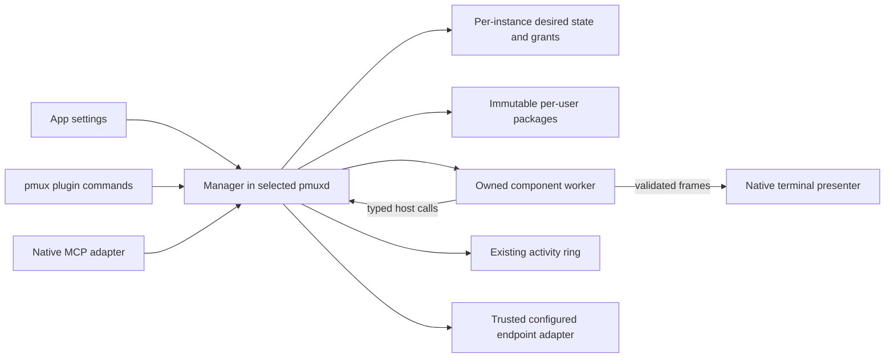

# Proposal: a versioned pmux plug-in system

Status: proposed, for owner review before implementation. The commands,
manifests and interfaces below do not exist yet. This proposal changes no
runtime behavior and does not authorize merging the held connector.

Use portable WebAssembly components with explicit host capabilities. Keep one
plug-in manager in each existing pmuxd instance. The daemon continues to own
the activity feed. Trusted native adapters handle terminals, configured remote
readers and MCP. Plug-ins receive neither the ordinary control socket nor
ambient filesystem, network or process access.

## What a user does

All examples in this section describe the proposed interface.

```sh
pmux plugin search activity
pmux plugin install org.moonbase.activity-monitor@1.0.0
pmux plugin inspect org.moonbase.activity-monitor
pmux plugin enable org.moonbase.activity-monitor --allow activity.read:local
pmux plugin run org.moonbase.activity-monitor:main
pmux plugin disable org.moonbase.activity-monitor
```

Install verifies a package without executing or enabling it. Enable records
the selected version and approved endpoint scope for the daemon selected by
normal [pmux target resolution](mux-cli.md). Run opens a view. Disable closes
that instance's plug-in views and revokes its tool calls. Other instances and
user sessions continue running.

Default plug-ins: the official activity monitor and activity connector start
enabled. When pmuxd starts, a background step looks at each of the two. If it
has no saved selection (enabled or disabled) and the binary's own verified
bundle carries it, the step installs that exact bundled version and enables it
with `activity.read:local` only. It goes through the same manager transition,
readiness check and journal as an explicit Install and Enable. A saved
selection is never changed, so a disable stays in effect. A build without the
official bundle seeds nothing. A failure is logged and never stops the daemon.
`PRISMATTYC_DEFAULT_PLUGINS=0` skips the step, for proofs of the manual flow.

The app offers the same install, permission and enable operations in Settings.
Installing or enabling the monitor does not turn on activity collection.
When collection is off, the view reports `feed_disabled` and links to the
app's Mux > Experimental activity setting. The app starts and configures its ordinary
daemon; the user does not launch a separate feed daemon.

The connector is another package using the same installation and capability
contracts:

```sh
pmux plugin install org.moonbase.activity-connector@1.0.0
pmux plugin enable org.moonbase.activity-connector --allow activity.read:local
pmux plugin invoke org.moonbase.activity-connector:seats --json '{}'
pmux-mcp --activity-only
```

The last command preserves the held connector's intended client interface.
It explicitly selects that package's four activity exports and advertises them
only while the package is enabled. A full MCP server retains its existing tools
and accepts an explicit `--plugins org.moonbase.activity-connector` allowlist.
Its default plug-in allowlist is empty. A package cannot replace a core tool
or automatically expose itself to every MCP client.

Management mutations require a running, compatible selected daemon. An absent
daemon returns `daemon_unavailable` with ordinary app/startup guidance; install
does not create a mux session as a side effect. Cached catalog search can work
offline. There is no offline writer for enabled state or grants.

## Current foundation and the change

The source baseline is [the activity launcher change](https://github.com/moonbase2090/Prismattyc/pull/405),
commit `87367051b21e89b4c367555fbc8d477396dc33e4`. At that baseline:

| Existing part | Contract to preserve |
| --- | --- |
| [Activity feed](agent-activity-feed.md) | Optional daemon-owned metadata ring, 512 retained records, pages of at most 256, independent epoch/sequence, explicit publisher hooks and typed disabled/reset behavior. |
| [Native monitor](activity-monitor-ui.md) | Direct monitor executable, per-host state/cursors, keyboard and resize behavior, snapshots, cell rendering and probed pixel support. |
| [Held connector proposal](https://github.com/moonbase2090/Prismattyc/pull/401) | Four bounded activity MCP tools, configured endpoint labels and finite query semantics. This remains a held proposal, not shipped behavior. |
| [Daemon startup and control](control-plane.md) | App, CLI and login start the same authoritative daemon. Existing socket clients have same-user trust and broad control operations. |
| [Updates and restart](update-and-restart.md) | Installed and running code can differ; live sessions must not be stopped implicitly. |

The separate `0.3.54` monitor/configuration delivery proceeds independently.
Its [configuration and packaging PR](https://github.com/moonbase2090/Prismattyc/pull/408)
at `4d2fbfd159d28720036974fa0d4b37f07a5b9068` establishes the migration contract
below. That PR is unmerged at the time of this update, and its release version
bump is separate. Confirm the final merged source before implementation;
neither this proposal nor the plug-in port gates that delivery.

The new work is a reusable package, API, permission and lifecycle contract.
Activity metadata is its first data capability. Installation and invocation
do not depend on activity-specific names or on the monitor's implementation.

## Ownership and process boundaries



The arrows between worker and presenter pass through the manager's validated
view channel. The worker never receives a terminal handle or a frontend
administration connection.

Each pmuxd manager is the sole writer of its instance's desired selections,
grants, endpoint definitions and runtime generations. CLI, app and MCP clients
ask that manager to act. The instance namespace uses the same resolved target
identity as the daemon lock, including custom sockets. It survives daemon
restart and does not use PID or activity epoch as identity. Alias and Windows
path normalization must agree with the existing target/lock implementation.

Packages and verified receipts are immutable per-user objects addressed by
publisher, plug-in ID, version and digest. Managers serialize publication under
a package-store lock and atomically publish complete objects. No shared
mutable package selection or grants file exists. Two daemons can use different
versions and endpoint grants while sharing identical bytes. Version conflicts
with different digests fail explicitly. Initial package garbage collection is
deferred, so one daemon cannot delete another's selected or rollback package.

The manager launches a private component-worker mode of the matching installed
core executable. That mode branches before normal daemon lock acquisition,
workspace restore, PTY creation, login work or socket binding. It is a runner,
not another feed daemon. Its inherited, dedicated channel binds it to one
manager and a server-minted worker ID. Updating core launch forwarders must
not accidentally select a different worker/runtime version. A launch mismatch
fails before component execution.

One worker owns each opened view's component state. A tool worker belongs to
one enabled package and daemon instance and starts lazily. No plug-in worker
owns a user PTY or appears in workspace restore. Worker I/O, compilation,
remote queries and terminal presentation stay outside the control-plane mutex.

## Package and discovery contract

A package contains `plugin.toml`, standard component bytes, bounded declared
assets/schemas and license notices. It contains no native entrypoint, install
hook or publisher-provided compiled native cache.

```toml
manifest_version = 1
id = "org.moonbase.activity-monitor"
version = "1.0.0"
plugin_api = ">=1.0.0, <2.0.0"
component = "monitor.wasm"

[requires]
"pmux:activity/read" = ">=1.0.0, <2.0.0"
"pmux:view/frame" = ">=1.0.0, <2.0.0"

[[contributions]]
id = "main"
kind = "view"
title = "Activity monitor"
```

The connector uses the same format. Its command contributions optionally name
MCP exports, allowing CLI and MCP registration to derive from one declaration:

```toml
manifest_version = 1
id = "org.moonbase.activity-connector"
version = "1.0.0"
plugin_api = ">=1.0.0, <2.0.0"
component = "connector.wasm"

[requires]
"pmux:activity/read" = ">=1.0.0, <2.0.0"
"pmux:tool/call" = ">=1.0.0, <2.0.0"

[[contributions]]
id = "hosts"
kind = "command"
mcp_name = "pmux_activity_hosts"
input_schema = "schemas/hosts-input.json"
output_schema = "schemas/hosts-output.json"

[[contributions]]
id = "seats"
kind = "command"
mcp_name = "pmux_activity_seats"
input_schema = "schemas/seats-input.json"
output_schema = "schemas/seats-output.json"

[[contributions]]
id = "recent"
kind = "command"
mcp_name = "pmux_activity_recent"
input_schema = "schemas/recent-input.json"
output_schema = "schemas/recent-output.json"

[[contributions]]
id = "poll"
kind = "command"
mcp_name = "pmux_activity_poll"
input_schema = "schemas/poll-input.json"
output_schema = "schemas/poll-output.json"
```

IDs are publisher-qualified, validated identifiers. Paths are relative regular
files within the verified package. Parsing rejects unknown required fields,
duplicate contributions, unsupported kinds, path traversal, links/reparse
entries, oversized files and invalid schemas. Install validates component
imports/exports statically without instantiating it. Assets reach a component
only through bounded host asset access, never a filesystem preopen.

Discovery reads the managed catalog and verified installed manifests. It never
executes a discovered file or searches PATH/project directories. The initial
catalog is the official publication source pinned by the app. Installation
requires immutable release provenance, expected size and SHA-256 from that
trusted source, following the core updater's source-trust model. A hash alone
does not authenticate a publisher. Self-declared publisher metadata grants no
authority. Additional catalogs and unverified local imports are deferred until
their publisher/key policy is reviewed.

Install stages privately, validates archive expansion limits and provenance,
then atomically publishes the object and receipt. Interrupted staging cannot
become an enabled package. Repeating an install of the same verified object
returns it. Mutable catalog refresh cannot replace installed bytes. Automatic
plug-in updates are off in the first version.

## Versioned public API

Keep these versions separate:

| Version | Meaning |
| --- | --- |
| Manifest version | Package metadata grammar, initially 1. |
| Plug-in API | Component lifecycle/event/reply contract, initially `pmux:plugin@1.0.0`. |
| Capability version | Each typed host contract, initially activity read, frame view and tool call at 1.0.0. |
| Activity schema | Existing metadata record schema 1. |
| Query JSON schema | Connector/CLI result contract, initially the held connector's schema 1. |
| Core protocol and package release | Existing control protocol and independently versioned app/plug-in releases. Neither implies component compatibility. |

The manager publishes a finite set of supported API and capability contract
versions. The installed component identifies its compiled contract versions
through component metadata and exports. Before execution, the host intersects
those versions with the manifest ranges and its supported set. It selects the
highest exact mutually supported version. For example, a host supporting API
1.0.0 and 1.1.0 selects 1.0.0 for a component compiled only for 1.0.0, even if
the manifest range also allows 1.1.0. Semver ranges do not make a component ABI
compatible by themselves. Supported bindings come from authoritative versioned
WIT definitions; adapters for older contracts must be explicit.

The initial `start` context contains the selected exact versions, admitted
contributions, resource limits and feature flags. `ready` confirms that context
before any view/tool dispatch. It establishes no guest-chosen identity or new
grant. The manager rejects a changed or unsupported confirmation. Each worker
channel also checks the matching core/runtime build before loading a component.

Preparation permits compilation, linking, bounded package assets/clock and
the readiness exchange only. Activity imports return `not_activated`; tool
events and view output are unavailable. The component starts reading/rendering
only after the manager commits selection and generation and admits the first
active event. The old version remains authoritative until that commit.

A required unknown capability or empty intersection returns
`incompatible_api` or `unsupported_capability` before start. Known optional
capabilities appear in an optional manifest table and receive a negotiated
availability result. A compiled optional import must have an explicit host
adapter returning `unavailable` when denied. An unresolved import never falls
back to native execution. The host sends only negotiated event variants and
rejects unknown variants or mismatched replies.

The component contract has one event handler. This is an interface sketch,
not a complete WIT definition:

```text
handle(event) -> result<reply, plugin-error>

event = start(context) | tool(call-id, contribution-id, bounded-json)
      | view(view-id, input-or-resize-or-tick) | stop
reply = ready | tool-result(call-id, bounded-json)
      | view-frame(view-id, frame) | idle

activity.endpoints() -> list<scoped-endpoint-handle>
activity.read(handle, optional-cursor, page-limit) -> result<activity-page, activity-error>
```

`start` accepts only `ready`; a tool event accepts the matching tool result or
typed failure. A view event accepts a frame for that view or `idle`. Replies
cannot create tool names, change permissions or target another view. The host
validates call IDs, schemas, bounds and reply kind before publishing results.

The native application client exposes complete operations rather than launch
steps:

```text
install(source) -> installed-package
enable(package, approved-scopes) -> status
disable(plugin-id) -> status
inspect(plugin-id) -> status
exports(approved-contributions, frontend) -> connection-bound descriptors
invoke(invocation-target, arguments) -> result
open-view(plugin-id, contribution-id, frontend) -> owned-view
update(plugin-id, verified-version, approved-scopes) -> status

invocation-target = admin-command(plugin-id, contribution-id)
                  | exported-tool(connection-bound-tool-handle)
```

Transport frames, registry records, Wasmtime objects, mux control enums and
Lunatui grids stay private. A dependency-light API crate owns WIT and domain
types. Generated bindings and manifest capability validation derive from those
definitions. Native CLI/MCP routers derive from manifest contributions.
Plug-ins do not depend on the full native mux crate.

Each MCP adapter obtains its contribution allowlist from its operator-provided
arguments or saved client configuration. The manager intersects that request
with enabled manifest exports and mints connection-bound tool handles. The
adapter holds no independent capability grants. Removed allowlist entries and
disabled/revoked contributions disappear from discovery and reject invocation.
MCP requests use only their admitted export handles; tool arguments cannot
select the administrative invocation form.
Supervision must preserve the original allowlist. `--activity-only` is an
explicit four-export selection, not an implicit global registration policy.

| Proposed module | Responsibility |
| --- | --- |
| `pmux-plugin-api` | Versioned WIT, pure domain types, generated guest bindings and validation metadata. |
| `prismattyc-mux::plugins` | Per-instance desired state, grants, package selection, instances, dispatch, revocation and complete management operations. Wire/storage internals are private. |
| Manager package store | Verified discovery and immutable publication. No enabled selection or independent grant policy. |
| Manager runtime | Owned component workers, imports, resource limits, cancellation and version-bound launch. |
| Activity provider | Typed local reads and trusted configured endpoint I/O. It never exposes the full control protocol to a component. |
| Native view and MCP adapters | Validated presentation/input and approved tool transport. No duplicate registry. |
| Monitor and connector packages | Pure model/layout/query logic and event handlers using negotiated capabilities. |

## Permissions and containment

Saved grants are separate from manifest requests. Install grants nothing.
The default plug-ins above are the one exception: they get
`activity.read:local` and no other grant. Otherwise, Enable requires approval
for requested data access, scoped to configured
endpoint IDs. View and tool imports require the matching declared contribution;
they provide access only to its own view or admitted invocation. They confer
no pane, mail, filesystem, publication or admin authority.

The first data capability, `activity.read`, exposes the existing bounded
metadata records, cursors and resets. It has no generic control-request tunnel.
The daemon stamps activity timestamps and sequence; seat names remain
caller-asserted metadata, not authenticated identities. Publication and hook
installation stay explicit trusted adapter operations outside plug-in v1.

Every host call checks the manager-minted worker identity, enabled selection,
generation, grant revision, negotiated operation and endpoint scope. Guest
strings cannot forge these handles. Local reads copy a bounded page from the
existing plane under its mutex, then release the lock before worker transport.
The manager maintains no second activity ring or durable event history.

The runtime links only reviewed imports. It provides no inherited stdin,
environment, raw filesystem, sockets, process creation, credentials or general
HTTP access to guests. Bounded clock, diagnostics and package assets are
explicit baseline imports. Unknown imports fail closed. Native third-party
libraries/executables and raw terminal output are outside v1.

This restriction is necessary because an unrestricted same-user native
executable can open today's ordinary control socket directly. A read-only RPC
broker, clean environment, private directory or signature would not contain it.
WebAssembly makes external operations depend on linked imports; correctness
still depends on the runtime and trusted import implementations. See
[Wasmtime's security model](https://docs.wasmtime.dev/security.html).

Configured remote readers are trusted native host operations. The owner can
create an endpoint with a fixed local socket or command/SSH configuration;
plug-ins can use only approved opaque endpoint handles. Neither tool arguments
nor component replies can supply executable paths or argv. The adapter owns
validation, SSH-safe argument construction, rate limits, streaming output
limits, deadlines and child cleanup. A read grant does not sandbox an
owner-selected helper or authorize creating one. No bot-provider credential or
outbound Grok API capability is needed for the four activity tools.

## Safe terminal views

A component returns a bounded framebuffer, not VT bytes or a widget language.
The native presenter owns raw mode, input decoding, terminal size, capability
probes, alternate-screen state, VT/Kitty encoding and restoration. The guest
receives keys only for its focused view, never global keyboard input.

Each frame has unsigned dimensions matching the admitted viewport, a cell grid
of styled UTF-8 grapheme clusters, and optional typed RGBA tiles. Validate the
whole frame before output:

- Check dimensions, cell counts, integer arithmetic and total byte budget.
- Reject ESC, C0/C1 controls and invalid text. Newlines use grid coordinates;
  they cannot appear as terminal controls inside a cell.
- Validate grapheme width and explicit continuation cells. Reject overlapping
  or out-of-bounds wide cells and invalid style/color variants.
- Check tile rectangles, dimensions and exactly four bytes per RGBA pixel with
  checked multiplication. Guests supply no terminal image identifiers or
  encoded escape sequences.
- Construct all terminal commands in trusted code. Invalid frames return
  `invalid_frame` before any bytes reach the terminal.

For example, a cell containing `ESC ] 52 ...` is rejected, an out-of-bounds
two-cell glyph is rejected, and a valid text-only grid renders through the cell
path. Image capability is optional and host-negotiated. Existing actual-upload
probes and cell fallback remain host policy; the baseline's query response
alone does not prove raw RGBA support. Windows retains cells until pixel proof
exists. There is no raw-output fallback.

A view belongs to one authenticated frontend connection and `ViewId`.
Frontend EOF, explicit close or disable revokes its handles and stops its
worker. Reconnect creates a fresh view; stale handles cannot adopt an orphan.
Each view has independent model state and a bounded input/output queue.
Resize replaces obsolete pending sizes, repaint frames can coalesce, and a
slow frontend cannot stall other workers. No implicit persistent detach is
offered in v1. Snapshot/no-motion behavior uses the same frame contract.

## Lifecycle and failure behavior

Persist desired state separately from observed state. Desired state is
`disabled` or `enabled` with selected digest and grants. Observed state includes
`stopped`, `starting`, `running`, `failed` and `incompatible`. Provider state
such as `feed_disabled` or `unreachable` is separate. Inspect reports installed,
selected and running versions, effective grants, failures and pending updates.

| Operation or failure | Required behavior |
| --- | --- |
| Enable | Validate compatibility and grants, atomically save selection, then admit lazy tool workers or explicit views. Repeating the same request is a no-op. |
| Disable | Commit disabled state and advance generation first. Reject new calls, cancel host work, discard queued replies/frames, close channels and stop owned workers. Repetition stays disabled. |
| Worker crash | Mark its view failed or its tools unavailable. Apply a bounded retry budget to tool workers; never replay an interrupted invocation. A view requires reopening. |
| Daemon crash/restart | Dedicated channel EOF ends workers. Startup reconciles only saved desired state, issues fresh handles/generations and honors saved disabled state. Activity readers handle the new feed epoch. |
| Upgrade | Verify/install new bytes first. Additional permissions leave the version pending approval while the old selection remains active. Check readiness before activation; commit selection and revoke the old generation as one manager transition. |
| Failed activation/rollback | Keep the old selection if readiness fails before commit. After commit, report failure and offer a retained compatible version under current grants. Rollback issues new handles and never replays interrupted calls. |
| Core rollback | Leave incompatible packages installed but stopped with a typed reason. Do not run a native substitute. |

Durable selections and grants use one atomic per-instance journal, separate
from workspace persistence. It sits in the instance's directory under the data
directory (`<data>/prismattyc/workspaces/<instance key>/plugins.json`), not
beside the socket, so it survives the reboot or logout that clears the runtime
directory. A journal that an earlier version kept beside the socket is moved
there by the next daemon to manage plug-ins. Retry IDs make administrative requests safe after
a lost response. Startup finishes or discards interrupted transitions using
the committed journal. PID alone never identifies an owned worker.

Revocation prevents future delivery but cannot recall metadata already read.
Cancellation cannot undo work already accepted by a trusted remote helper.
Changing plug-ins never invokes a session-stopping daemon restart.

The host sets limits for guest memory/tables, fuel or epoch execution,
compilation, frame/result sizes, pending calls and aggregate workers. Initial
budgets are implementation acceptance inputs, not performance claims. Host
imports require separate cancellable deadlines; fuel/epochs cannot interrupt
a guest blocked inside native host code. A worker that fails its shutdown
deadline is terminated and reaped. See
[Wasmtime execution limits](https://docs.wasmtime.dev/api/wasmtime/struct.Config.html#method.epoch_interruption).

## App-managed activity collection

Preserve the shared configuration key from the independent delivery:

```toml
[mux]
experimental_activity = false
```

This proposal shipped with a default of false. The default is now true;
false opts out of metadata collection. pmuxd reads this
setting during startup and watches the config for live changes. The existing
`--experimental-activity` flag also works; the effective state is flag OR key.
An unreadable startup config retains the default-off setting unless the flag
is set. A later unreadable or invalid config preserves the running state.
The settings editor calls the key Experimental activity under Mux, with the
timing "Live: pmuxd applies it within a second; no restart".

The daemon-owned watcher polls modification time and size every 500 ms. It
reads/parses outside the control-plane mutex and applies a valid changed value
under that mutex. This covers app-managed startup, `pmux up`, login restore,
restart and file edits without another feed daemon or a GUI-only writer.
Neither the setting nor the watcher restarts pmuxd or changes sessions, panes
or mail.

Turning the effective state on creates a fresh feed and epoch. Repeated true
values preserve an already-enabled feed. Turning it off drops the ring;
subsequent reads and publication return `activity_disabled`. Turning it on
again cannot replay discarded records. An explicit startup flag keeps the
effective state on even when the key is false.

Settings and the plug-in view must distinguish the saved preference from the
actual feed state while a change is pending or cannot be read. A plug-in may
report `feed_disabled` and explain the setting, but cannot change it or restart
pmuxd. The native monitor's disabled hint names the key and supplies no restart
command. Enabling a reader installs no hooks. Preserve this one daemon-owned
reload path rather than adding a second setting writer or restart mechanism.

## Cross-platform distribution

The same standard component package runs on supported Mac, Windows and Linux
hosts. The native manager, worker mode and presenter ship with the corresponding
core binaries through existing [release packaging](release-process.md).
Plug-in versions do not share the app version or MSI ProductVersion.

The native monitor delivery being migrated has these packaging contracts:

| Platform | Existing delivery contract to retain at cutover |
| --- | --- |
| macOS | `Prismattyc.app/Contents/MacOS/pmux-activity-monitor`, with a PATH link beside the pmux link. The independent `.pmux-activity-monitor-prismattyc-shim.json` ownership record controls link removal during uninstall. |
| Linux | A separate monitor release asset and tarball `bin/` executable, installed with its man page by `install.sh`. The current per-binary `pmux update` does not fetch it. |
| Windows | ZIP/MSI `bin/pmux-activity-monitor.exe`, plus a `cmd/` forwarder on the MSI PATH. |

Its `--version` reports the Prismattyc release. Keep that launcher contract;
`pmux plugin inspect` separately reports the selected plug-in package version.
The monitor is deliberately outside `release_update::BINARIES` because older
installation/rollback paths require all binaries in that fixed list. Account
for updater-only installations during the later migration; do not add a new
mandatory core binary merely to install a plug-in package.

Installed plug-ins live under the platform user data directory in a private
`prismattyc/plugins` store. They remain outside the signed macOS app bundle,
Windows MSI-owned program tree and core updater's executable list. Existing
Unix owner checks and Windows DACL/reparse-point checks protect that storage
from other users. Component imports establish the guest permission boundary.

| Platform | Proof required before shipping |
| --- | --- |
| macOS universal | Sign/notarize the worker-containing executable with the app. Prove the selected runtime backend's executable-memory/entitlement requirements and supported deployment minimum. Current hardened signing alone is no sandbox proof. |
| Windows x64 MSI/ZIP | Verify worker-mode resolution, inherited handles, Job cleanup, version-directory updates, Unicode paths and terminal restoration. No symlink privilege should be required. |
| Linux x64/ARM64 tarball | Preserve supported architecture/libc requirements; exercise packaged workers, terminal behavior and remote-reader cancellation. |

Pin a released runtime compatible with the project's Rust toolchain and
platform minima. Prove dependency size and startup cost before accepting it.
Upstream support tiers vary by target and do not establish application proof;
see [Wasmtime support tiers](https://docs.wasmtime.dev/stability-tiers.html)
and [platform requirements](https://docs.wasmtime.dev/stability-platform-support.html).
Do not silently broaden macOS entitlements or deployment requirements to make
a development build pass. An interpreter is an alternative only after its
own correctness and performance checks.

Never deserialize publisher-provided precompiled native artifacts. Optional
compiled caches are host-created, private, disposable, and keyed by component
digest, runtime version, target and compiler settings.

## Refit the first two plug-ins

This is a substantive adapter and consumer port. Existing Lunatui terminal
sessions, native input, threads, sockets and subprocess readers cannot simply
be compiled for WASI unchanged. The pinned terminal library has an unsupported
third-target session stub. Reuse pure model/layout/query code only where an
actual component compile/render spike proves it works.

1. Let the independent `0.3.54` delivery finish and confirm its final source
   against the recorded configuration, live application and packaging
   contracts. Reuse its daemon-owned watcher, flag/key precedence, fresh epoch
   on enable and ring drop on disable. Do not restart the daemon to toggle it.
2. Prove the generic runtime and version/grant lifecycle with a small fixture
   component unrelated to activity. Prove host-rendered cells/images on all
   packaged targets before committing to the monitor port.
3. Extract pure activity records, retained-query transforms and monitor state
   from native mux dependencies. Preserve 512-record retention, 256-record
   pages, resets, finite query watermarks and cursor advancement over filtered
   events. CLI tail and legacy monitor tail retain their distinct replay defaults.
4. Convert the monitor to view events and validated frames. Move raw terminal,
   local socket and command/SSH work into trusted generic adapters. Managed
   packages contain no direct control-socket or child-process path. Preserve
   host separation, stale/disconnected indicators, catch-up fades, filters,
   sort, timelines, keyboard handling, resize, snapshots and no-motion mode.
5. Move the held connector's four queries into its component. Keep rmcp/Tokio
   and stdio supervision in the native MCP adapter. Replace per-query PATH
   lookup/pmux subprocess calls with manager invocation. Enforce output limits
   while reading, rather than after collecting an entire subprocess result.
   Preserve activity-only/full router selection and interrupted-call errors.
6. Import explicit old host definitions through an administrator-confirmed
   migration. Preserve labels where unique, accept existing valid 24-character
   monitor and 64-character connector labels, and use stable opaque endpoint
   IDs internally. Reject collisions for correction. Never infer an argv from
   plug-in data or silently launch an old helper after permission denial.
7. Publish both packages for the replacement release, then migrate installed
   entrypoints together. The shipped direct monitor name and any activity CLI
   aliases delegate to the registry's single implementation. Remove the old
   direct socket/query engine from distributed consumers in that delivery.
   A missing/disabled package produces installation/enable guidance, never a
   sibling/PATH or standalone bypass. Keep the usable shipped monitor until
   replacement parity is proven. Preserve owned PATH-link removal, MSI
   forwarders, man-page installation and launcher `--version`. Prove migration
   for Linux per-binary-updater users so a stale native monitor cannot become
   an unintended unmanaged path.

No implementation step above is part of this documentation change. The held
connector stays held until the owner agrees to the plug-in interface.

## Alternatives and owner decisions

Two complete shapes were compared. A native-process API preserves existing
TTY code and has lower initial migration cost. With normal user authority it
cannot enforce the requested read-only boundary. Native containment would
require distinct verified macOS, Windows and Linux policies; missing controls
would have to fail closed. Loading native libraries in pmuxd shares its full
authority and crash risk.

The selected component shape requires more adapter work but gives permissions
an enforceable host boundary. A separate per-user plug-in service was also
considered. Per-instance daemon ownership avoids a second service lifecycle
and grants writer. Offline activation and global mutable registry management
are deferred. A raw terminal API and a general widget language are both
excluded from the initial frame contract.

Owner review should decide whether to accept:

- Contained components as the v1 execution model, with native plug-ins deferred.
- Per-instance daemon ownership, private matching-version workers and no
  offline activation or initial shared-package garbage collection.
- Host-rendered cell/RGBA views and the resulting monitor adaptation cost.
- Official-source packages first, explicit grants and updates (except the two
  default activity plug-ins' local grant, an owner decision), and no additional
  catalog/local-import policy until separately reviewed.

The first authorized implementation unit, after approval, should test runtime
compatibility, signed worker launch and rendering portability. It may reject
this execution model before catalog or consumer migration work begins. No
schedule estimate substitutes for that result.

## Acceptance evidence required for implementation

The eventual implementation needs real packaged behavior proof:

- A third-party-style fixture installs without execution, negotiates exact
  versions, and cannot read user files, connect to the admin socket, spawn a
  process, access network/credentials or invoke an undeclared capability.
- Disabled/revoked generations, forged handles, unknown imports, malformed
  frames and oversized arguments fail at the host boundary. Include ESC/OSC,
  wide-cell, integer-overflow and oversized-image cases.
- Crash, host-call timeout, frontend EOF, slow readers, daemon restart and
  interrupted upgrade leave saved disabled state authoritative and unrelated
  sessions usable. Calls are never replayed. Two daemon instances retain
  independent grants and selections.
- App-managed collection honors the key and explicit flag at app/login/CLI
  startup and applies valid edits live without restarting the daemon. Prove a
  fresh epoch on enable, ring drop and `activity_disabled` on disable, unchanged
  state after unreadable config, and preservation of sessions, panes and mail.
- Both first packages preserve actual monitor cell/pixel/input/resize/snapshot
  behavior and connector cursor/reset/watermark/router behavior on the shipped
  Mac, Windows and Linux matrix. Core/plugin upgrade and rollback are exercised
  from the separately shipped monitor release.

This proposal has source and document validation only. Runtime containment,
component portability, package activation and UI parity remain unimplemented
and unproven.
