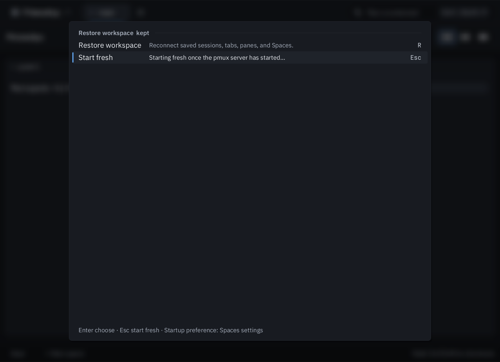
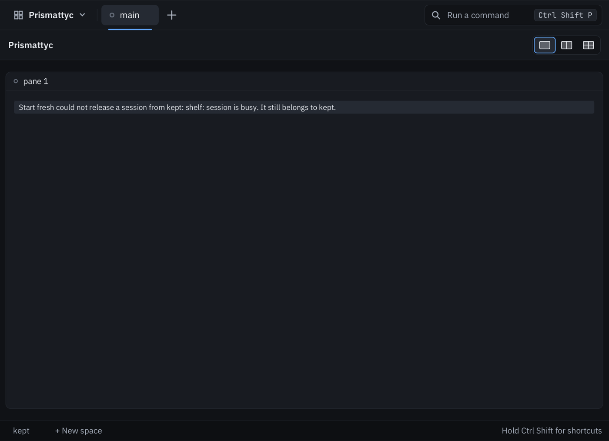

# Launch choice follow-ups: proof

`tests/native/start-fresh-choice-e2e.py`, in a fresh macOS 26.6.2 arm64 VM,
built in the VM and deleted after. All four cases passed in both runs
(`macos-results.json`). The app's startup `pmux up` is held for 8 s, so keys
arrive while the server is still starting.

- `fresh`: Esc during the held startup selects Start fresh and shows
  "Starting fresh once the pmux server has started…". When startup returns,
  the window is empty, and the saved session keeps its process but leaves its
  Space.
- `fresh-release-fails`: the same, with a `pmux` wrapper that refuses
  `space remove`. The session keeps its process and stays in its Space. The
  app shows "Start fresh could not release a session from kept: shelf:
  session is busy. It still belongs to kept." as an error.
- `restore` and `slow`: unchanged; Restore brings the Space back.

| Esc during startup | A failed release |
| --- | --- |
|  |  |

The release itself runs on a worker thread:
`restore_prompt::tests::the_release_runs_off_the_calling_thread` checks
that the call returns while `pmux` is still blocked. With the release made
synchronous again, it fails.
