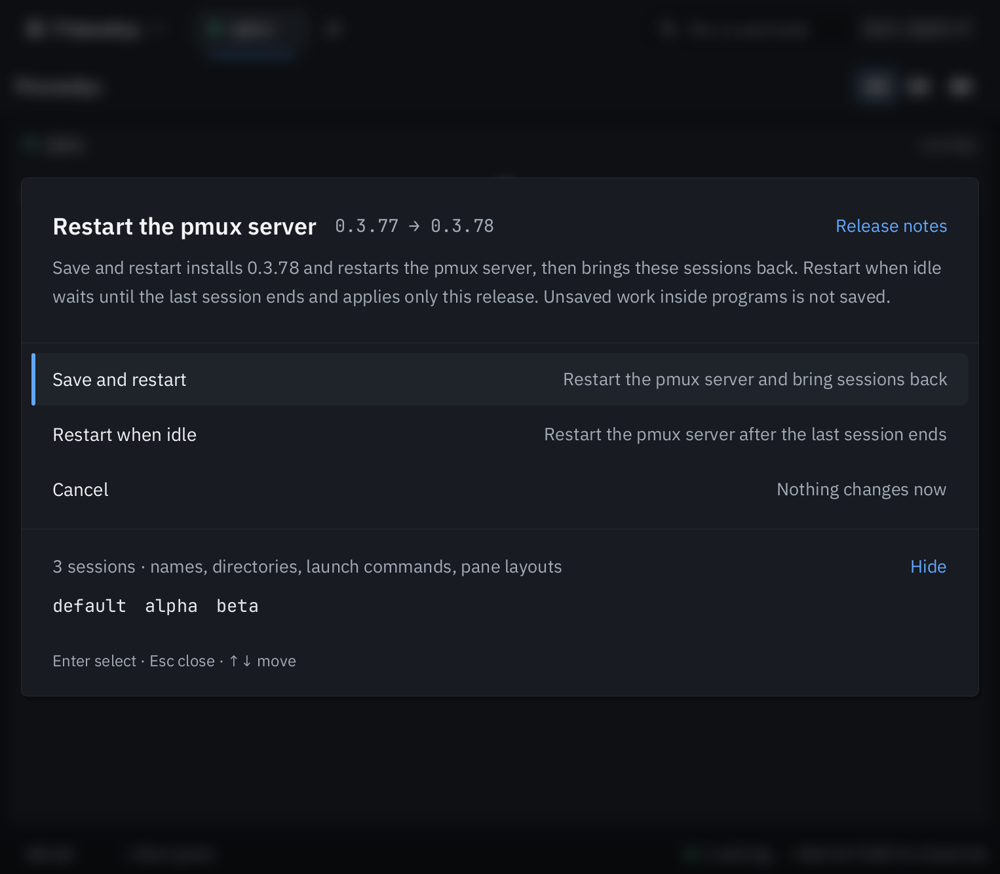
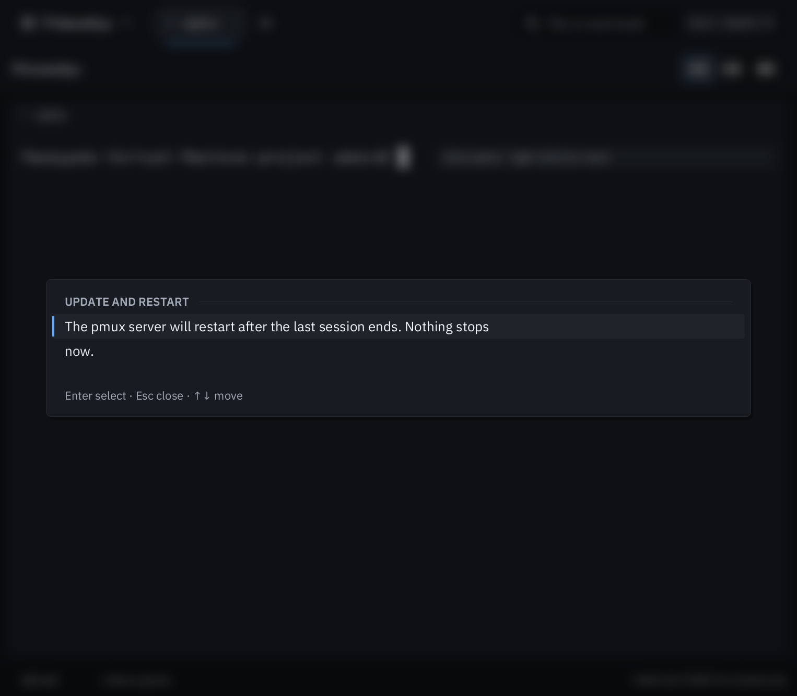
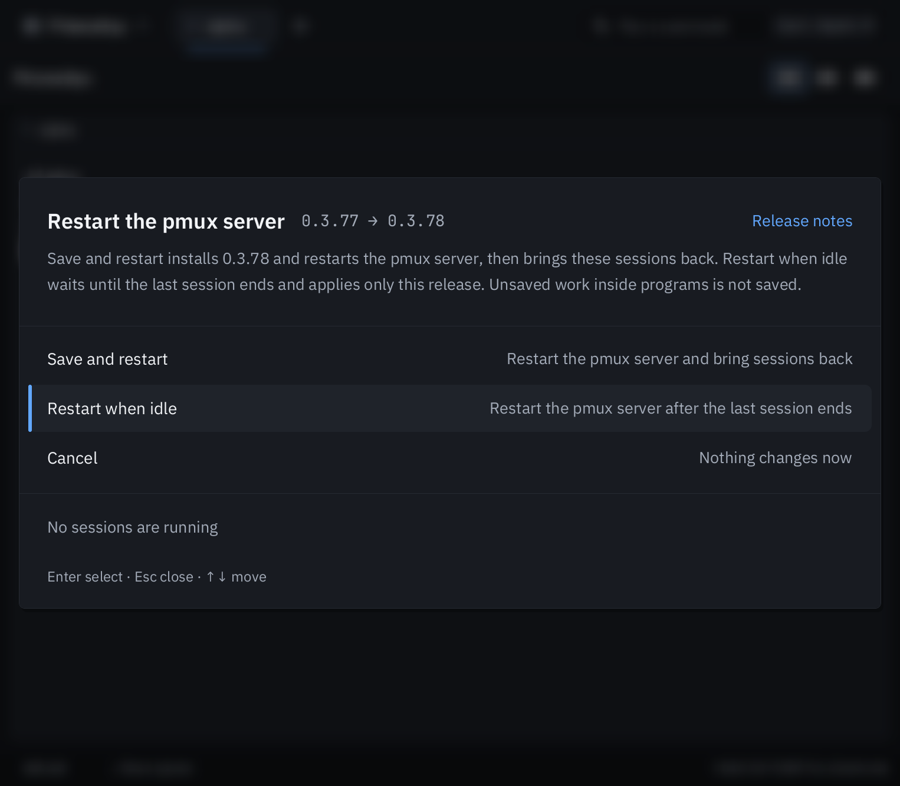
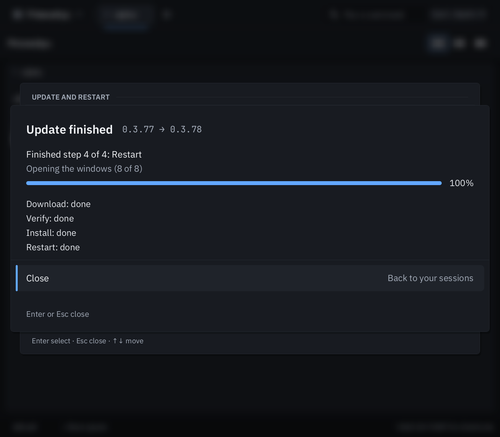
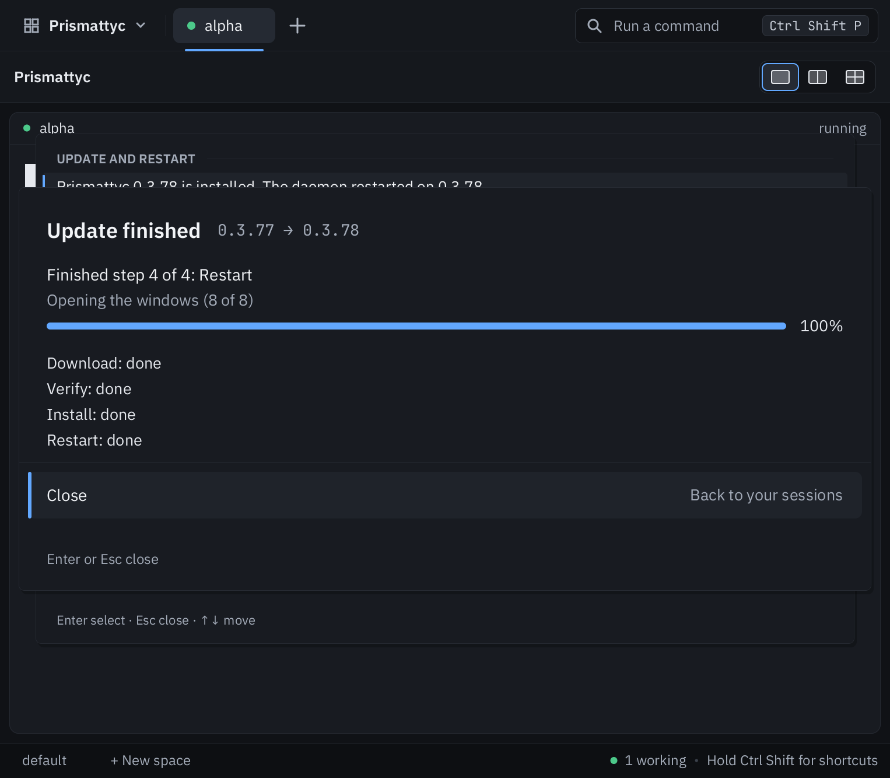
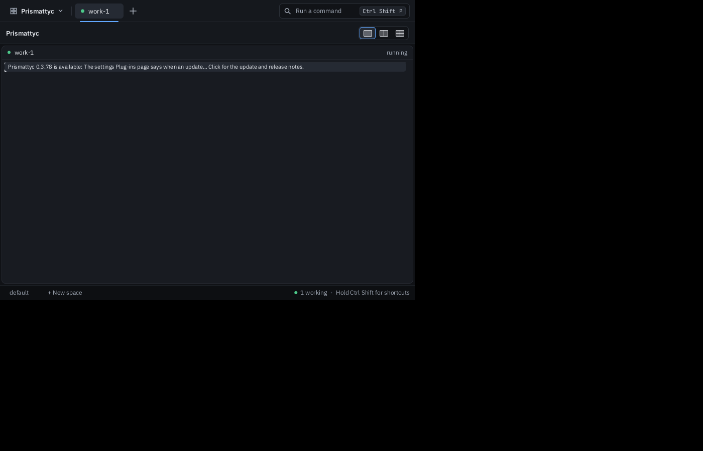
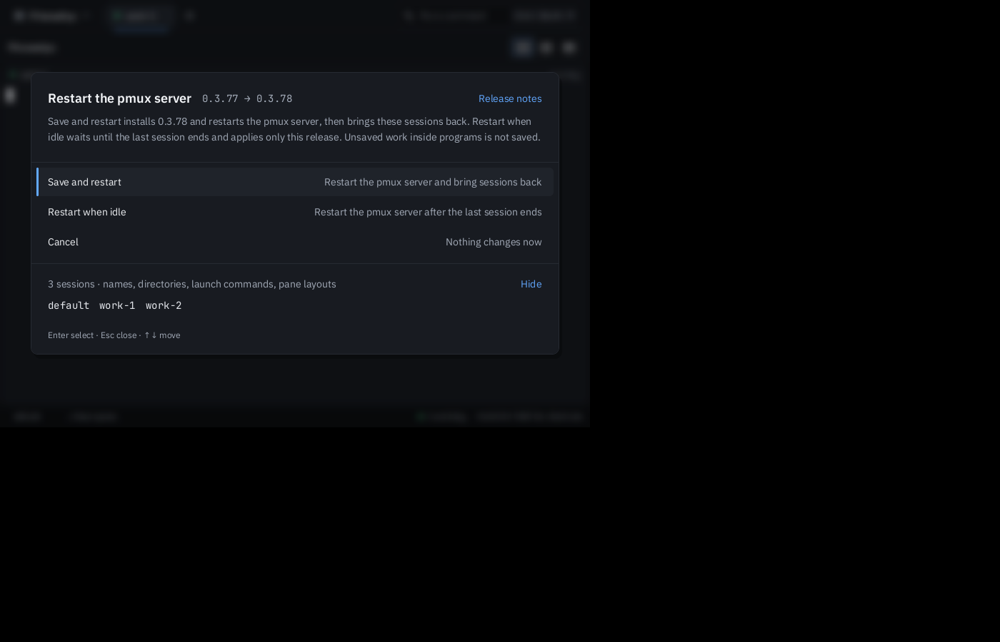

# One-confirm restart

Presented frames. The macOS frames are the host framebuffers passed to presentation. The Linux frames are the guest display root.

## Private daemon

`sessions.png`, `idle-choice.png`, and `idle-waiting.png` are from a private daemon on a logged-in Mac. Review Update opened one dialog. Save and restart was selected and the sessions were listed. Restart when idle was the next choice and left the sessions running. That recording used the logged-in desktop.

## Clean macOS guest

The dialog and the decision are commit `4b21cf4c69b631c78fc105aadc9fb0c04e0de9e5`, built as 0.3.77. The workspace version was lowered only in that build tree. The binaries were built outside the guest, because that guest had no compiler toolchain, and the build paths were remapped. Save and restart, and the idle restart, then install and run the published 0.3.78 updater (`98afcabb5b80`).

Review Update opened one dialog, "Restart the pmux server", 0.3.77 to 0.3.78. Save and restart is the first choice. Restart when idle is the next. The sessions are default, alpha, and beta.

Restart when idle left the sessions running. The panel says the pmux server will restart after the last session ends, and that nothing stops now.

After the remembered release was no longer the release just checked, the dialog opened again on top. Down selected Restart when idle. Escape closed the dialog. The frame lists no sessions because they had already been closed to reach that check.

Closing the last session installed 0.3.78 and finished the restart, step 4 of 4. The receipt said no sessions were restored, because those sessions had already ended.

Save and restart finished on 0.3.78. The receipt restored default, alpha, and beta, and their programs started again. The frame shows alpha running, and the line that 0.3.78 is installed and the daemon restarted on 0.3.78.

## Linux notice

A fresh Ubuntu 24.04.5 aarch64 guest built the same commit with rustc 1.90.0. Resource-fork sidecars in the copied tree were removed before the build. Build paths were remapped. The workspace version was lowered only in that build tree, to 0.3.77. The published 0.3.77 archive was installed with its own installer, then the core binaries were replaced with this build. The activity monitor stayed the published 0.3.77 binary.

`tests/native/one-step-update-e2e.py --notice --screenshots` clicked the update notice.

The notice says Prismattyc 0.3.78 is available.

The click opened one dialog, "Restart the pmux server", 0.3.77 to 0.3.78. Save and restart is selected. Restart when idle is the next choice. The sessions are default, work-1, and work-2. Escape closed the dialog. The click installed nothing.

The same drive then ran the update. It installed 0.3.78, left the daemon deferred because sessions were still running, and left the open window deferred because that window had an exact secondary-pane view. A second update found the release current and the daemon still deferred. The drive reported six passing checks.
