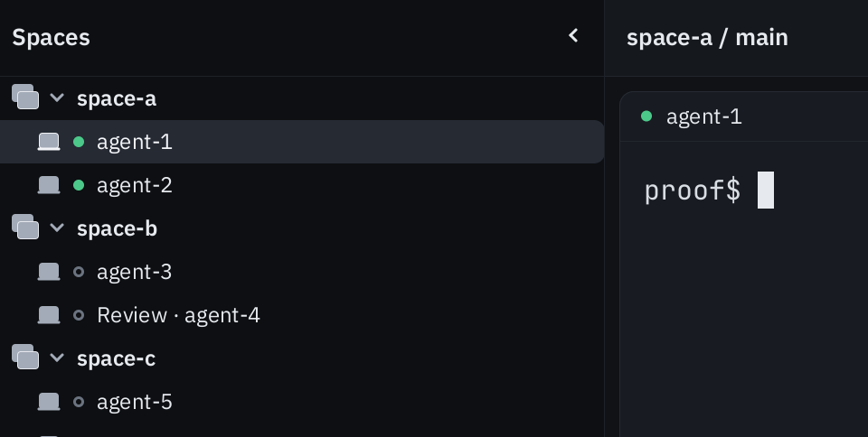

# Sidebar label proof

The clean-VM attempt tested application revision `9935200760b9fd29d432519d80aca399627e1861` on macOS 26.6.2, build 25G83, using the Core Animation tiles presenter. All four binaries were built together on the host and hash-verified in the guest. This is guest runtime execution, not guest compilation.

Preparation succeeded with six named targets and the daemon bootstrap session. All seven session/window/pane/child identities were retained for cleanup. One persistent VNC connection supplied the OS capture.

The crop shows `agent-1`, `agent-2`, `agent-3`, `Review · agent-4`, and `agent-5`. The initial OS capture clips `agent-6`, so the mandatory complete six-label visibility gate failed. The native click/selection sequence did not run. No input, visibility repair, reconnect, permission change, product edit, or setup retry followed the failed gate. This PARTIAL result does not establish native selection invariance or the cause of the capture limitation.

The crop preserves the source pixels without resizing. Raw desktop captures remain private because background applications contain environment details. [manifest.json](manifest.json) records the tested revision, immutable fixture/archive hashes, crop hash and exact pixel rectangle, zero input events, and cleanup results.

Finalization reported `CLEANUP_PASS`: the owned host, daemon, and all seven initial session children were absent. The guest archive hash and every regular archive member were verified on the host before the VM was stopped/deleted. The VNC process and deadline watchdog were also absent. The turn ended within its original deadline, with no running VM in the post-delete inventory.

Native UI proof remains pending. This result does not replace the existing scoped unit/non-GUI passes, waive the occupied-pane workspace test failure or strict Clippy failure, or establish a whole-Scorecard/coverage pass.
