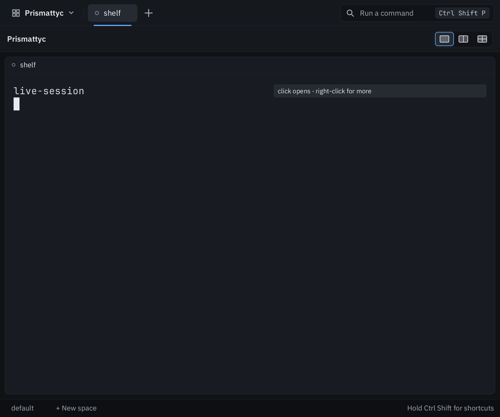
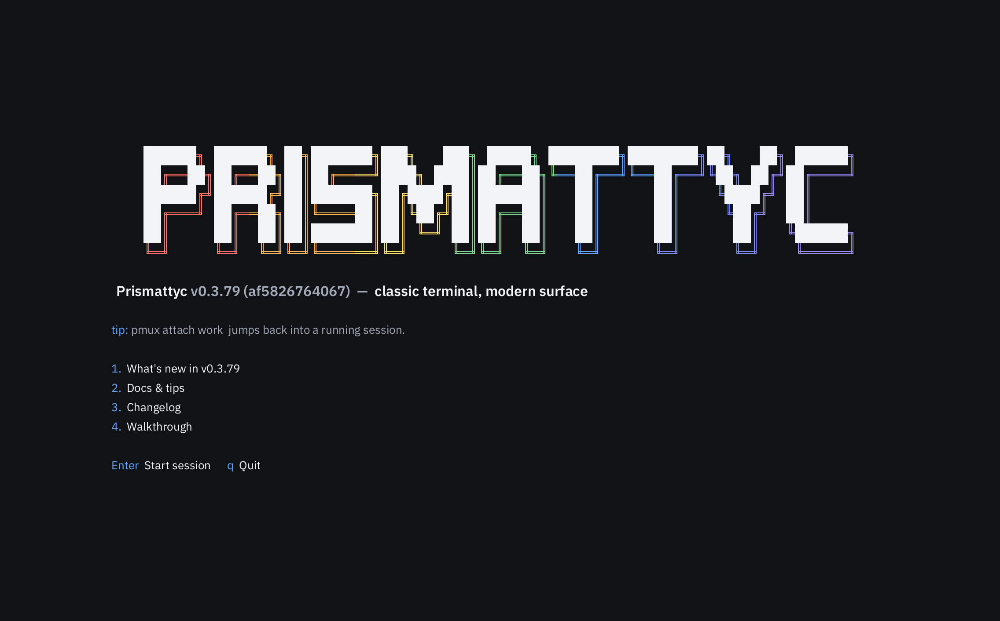
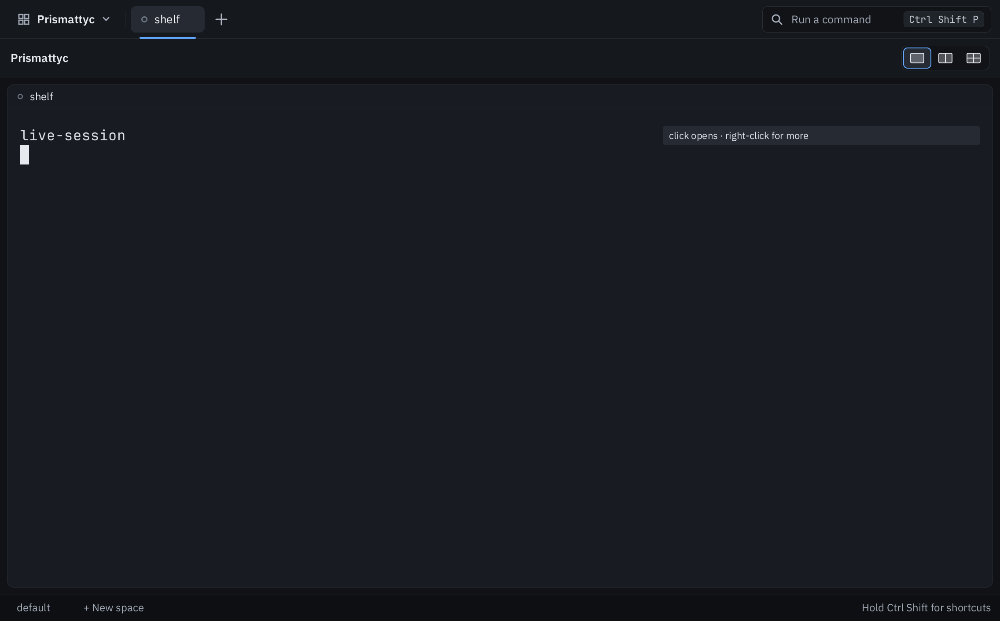

# Launch splash with a session already running

Presented frames from the macOS host. Each image is the framebuffer passed to presentation, not a picture of the desktop.

A private server had two sessions. The launch attached the one named shelf. That pane had already printed `live-session`. The same process was still alive after the splash was dismissed.

The before frame is the previous host. It attached the session and showed the workspace with no splash.

The after frame is this host, built from the commit that shows the splash on that launch.

Dismissing the splash shows the same session text.

The two host gate tests passed on this Mac with rustc 1.90.0: a first window shows the splash, and a later window, the config editor, completing an update, an explicit program, and the existing opt-outs skip it.

The window test that covers a fresh launch and a launch that attaches a session is compiled only on Linux. It runs in CI. It was not executed on this Mac.

A clean guest was not used for these frames.
